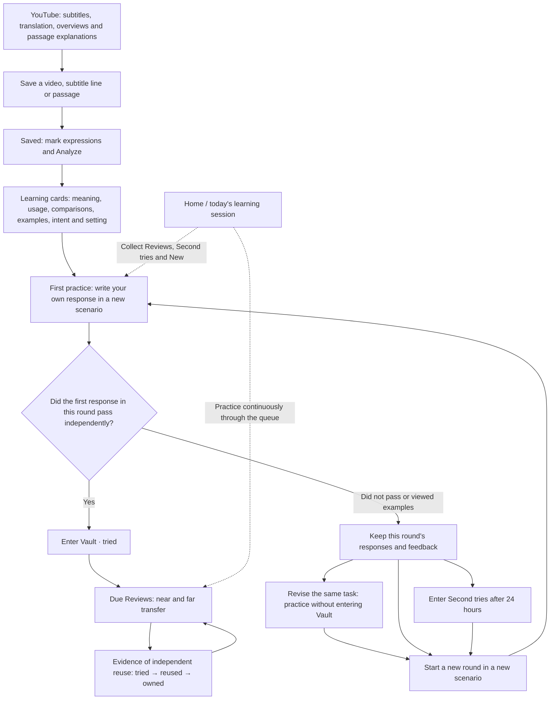
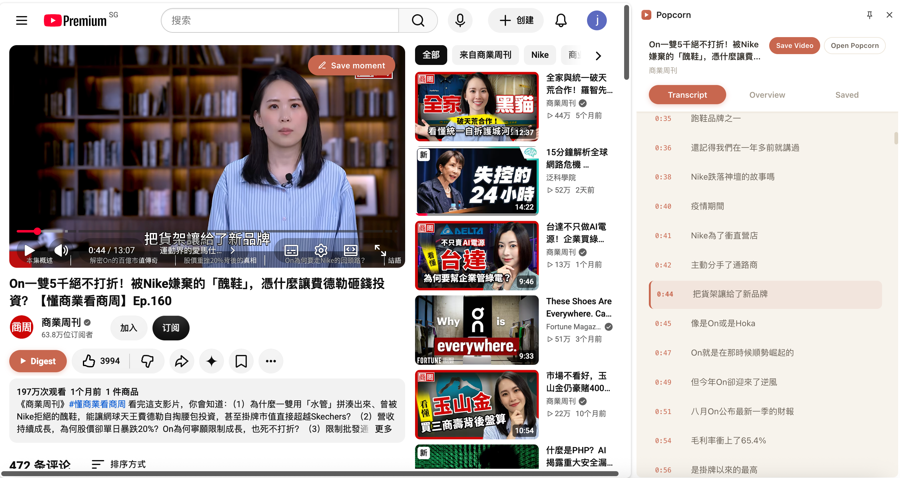
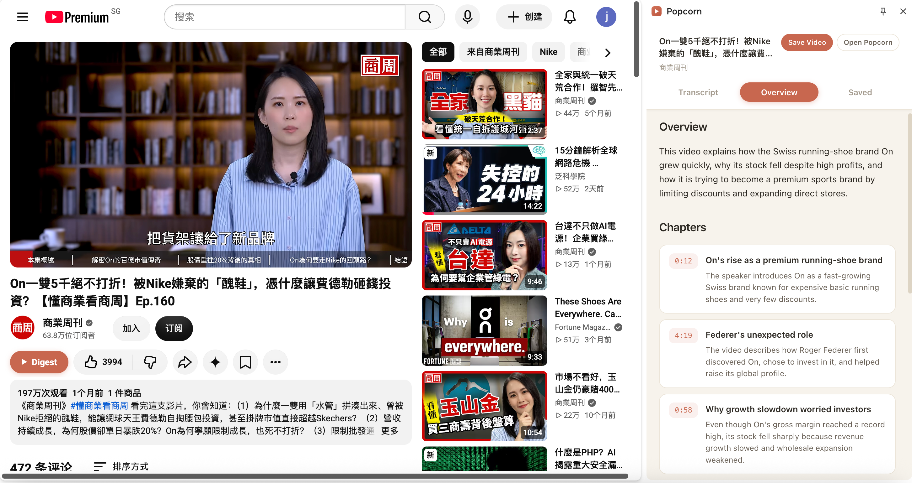
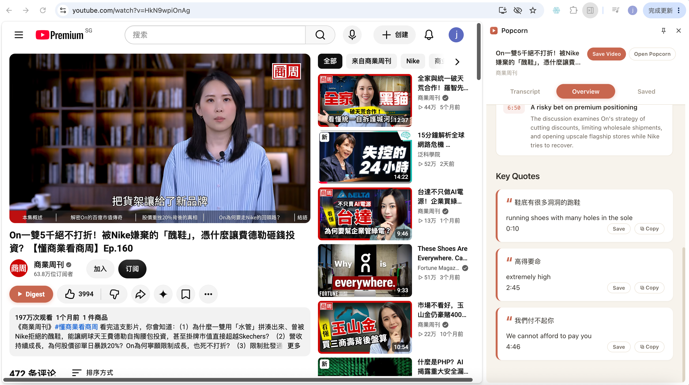
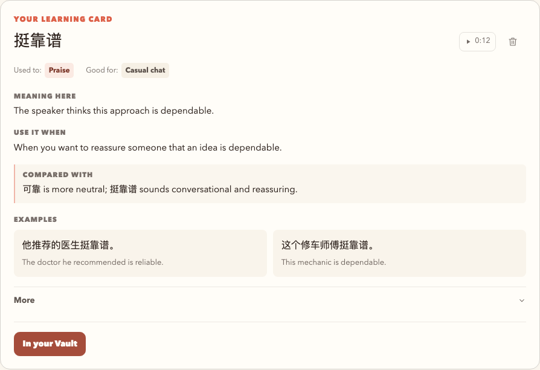
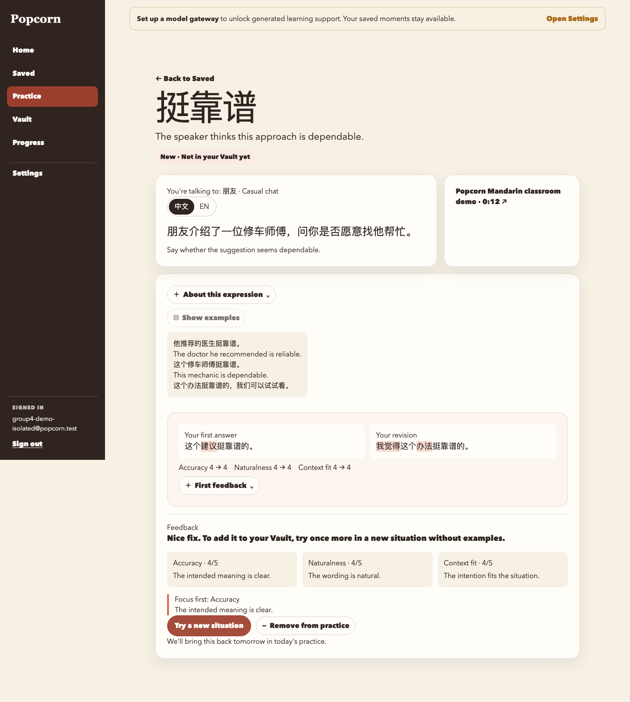
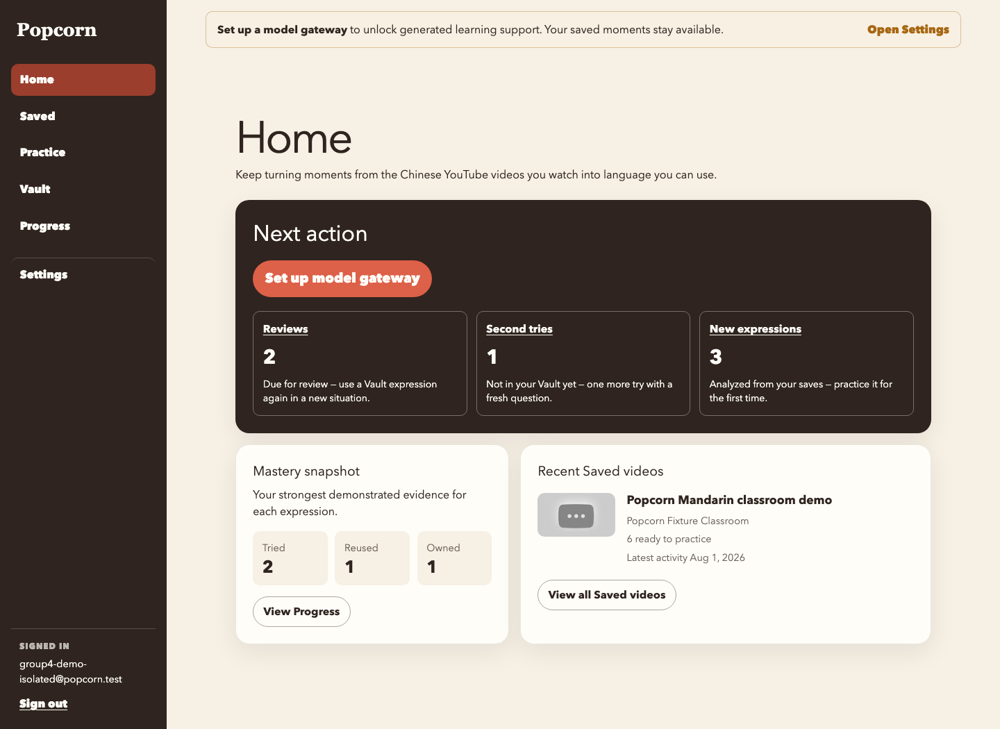
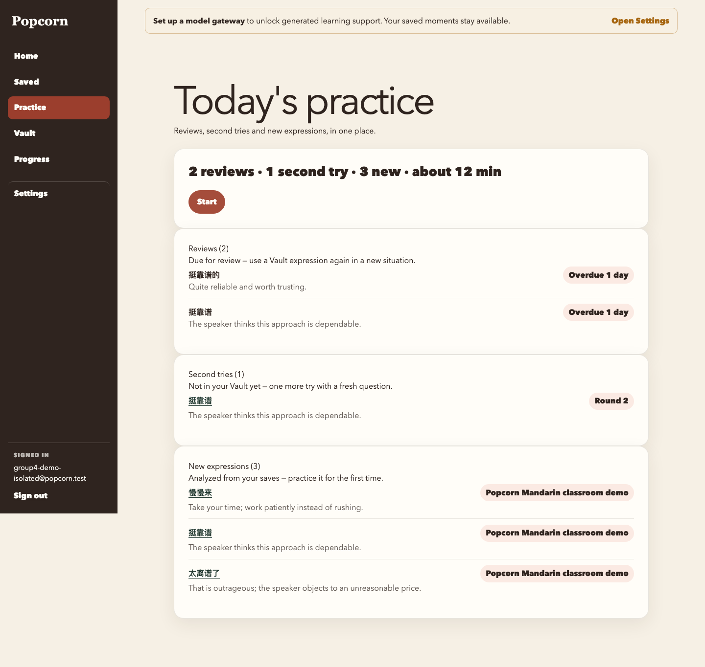
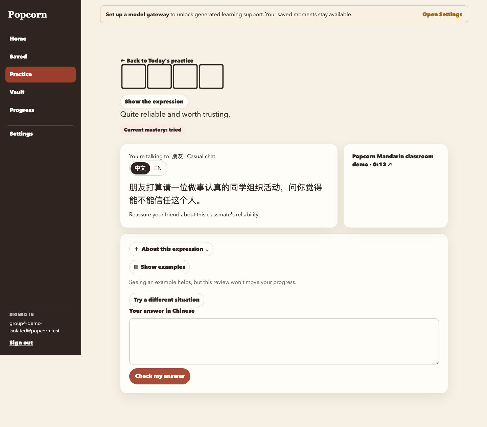
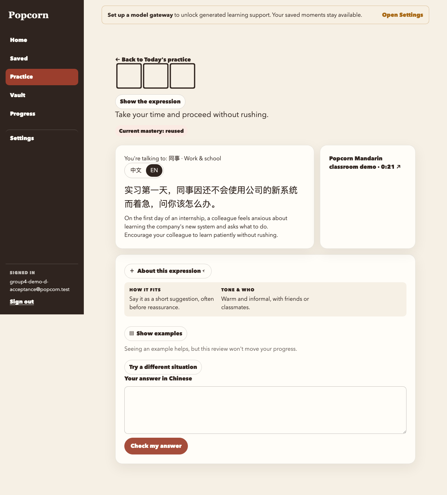

# Popcorn

**Turn Chinese expressions you understand on YouTube into expressions you can use yourself.**

Popcorn is for intermediate learners of Mandarin Chinese who use English as a support language. It combines a **Chrome extension + web learning workspace**. Understand and save authentic material from videos, mark expressions in Saved and generate learning cards, then build a record of your own use through responses in new scenarios, AI feedback, and spaced review.

Popcorn runs locally as a personal, self-hosted application and supports your own OpenAI-compatible model service.

**English** · [简体中文](README.zh-CN.md)

[Learning workflow](#learning-workflow) · [Features and interface](#features-and-interface) · [Tech stack](#tech-stack) · [Run locally](#run-locally) · [Validation and boundaries](#validation-and-boundaries)

## Why Popcorn

**Understanding an expression once does not mean you can use it next time.** Subtitles and translation help with comprehension, but learners still need to choose expressions, produce their own responses, and reuse them later. Popcorn connects these steps: each expression retains its original context, each response receives feedback, and progress depends on evidence of independent use.

## Learning workflow



Saving, reading learning cards, and viewing feedback do not automatically advance mastery. **Saved holds material you want to learn; Vault holds expressions with formal evidence of use.** Improving a response to the same task creates a practice record; an independent first response in a new scenario can establish new qualifying evidence.

## Features and interface

The extension screenshots below show actual viewing sessions. The updated web screenshots come from a production build of the current Phase 1 code with an isolated test account. Web learning cards, tasks, responses, and scores use fixed demo data to illustrate the interaction; **they do not represent live model output quality or learning outcomes**. Click screenshots to enlarge them. See the [screenshot record](docs/assets/readme/SCREENSHOTS.md) for their provenance.

### 1. Understand and save on YouTube

The extension provides Chinese, English, or bilingual subtitles while watching, with timestamps linking to the original lines. Generate video overviews, chapters, and expression recommendations as needed, or select original text for an English explanation. Save a learning snapshot of the whole video, the current moment, a subtitle line, or a selected passage, then view it in Saved on the web using the same account.

[](docs/assets/readme/youtube-watching.png)

| Overview · Summary and chapter navigation | Overview · Expression recommendations |
| :---: | :---: |
| [](docs/assets/readme/extension-overview.png) | [](docs/assets/readme/extension-overview-expressions.png) |

Saving persists the original content first; background jobs then fill in subtitles and learning material. If sync temporarily fails, the extension retains pending content and retries. **Save Video stores the source and a learning snapshot; it does not download video files.**

### 2. Select expressions in Saved and generate learning cards for practice

Saved organizes captured passages and their original context by video. Select and mark expressions in the original text, or adjust automatic markings. Click **Analyze** to analyze the marked content, with success, processing, or failure shown for each item and successful cards retained.

Learning cards explain both what an expression means and when you can use it:

| Content | What it helps you understand |
| --- | --- |
| **Meaning here / Use it when** | What does it mean in this video? In what situations can you use it? |
| **Compared with** | How does it differ from similar expressions? |
| **Examples** | Two Chinese–English examples showing the expression in complete sentences. |
| **More: How it fits / Tone & who / Watch out** | How does it fit into a sentence? Who can you say it to? What tone or usage restrictions apply? |
| **Used to / Good for** | Communicative intent and suitable settings, used in later task generation and scoring. |
| **Source timestamp** | Return to the original context on YouTube at any time. |

[](docs/assets/readme/learning-cards.png)

Items unsuitable as reusable expressions, such as personal names or basic words, include an explanation. You can choose **Practice anyway**, but these items do not automatically enter today's new expressions. Cards offer actions such as **Practice this expression / Continue / In your Vault**, depending on practice status.

### 3. First practice: respond yourself, then view feedback

Start from Saved or today's new expressions. Tasks are generated from the learning card's communicative intent and settings, with a conversation partner, a Chinese scenario, an optional English explanation, and a specific task. The source timestamp link remains available. For example, practicing “挺靠谱” involves expressing approval or trust in a new scenario.

- **Layered hints**: About this expression explains usage and tone. Show examples reveals example sentences and records assistance. Switching to English or viewing About does not count as example assistance.
- **Feedback across three dimensions**: Accuracy, Naturalness, and Context fit each receive a score and explanation, with priorities for improvement. Expand a natural version to compare it with your response word by word. Full scores display Nothing to fix.
- **Revisions and new rounds are separate**: the first response, latest revision, and initial feedback are retained. Revisions to the same task do not count as additional independent reuse. Before an expression enters Vault, you can keep revising, switch to a new scenario, or wait for a Second try. There is no limit on practice rounds.
- **Entering Vault**: an expression enters Vault as `tried` when the first response in a round passes independently. If you viewed examples or the first response did not pass, repeated revisions cannot qualify that round for Vault; you need another independent attempt in a new scenario. Expressions that have received a response but have neither entered Vault nor been removed enter Second tries when due, initially after 24 hours.
- **Pause and resume**: unsent drafts are saved automatically when browser storage is available; submitted responses and feedback are restored from the server. An expression with a generated first-round task but no response remains New, and refreshing resumes the same task. Use Remove from practice with a 5-second Undo window.

<details>
<summary>View response comparisons and feedback from first practice</summary>

[](docs/assets/readme/first-practice-feedback.png)

</details>

### 4. Home and today's learning session: know what to do next

Home summarizes three groups using the same counts and grouping as Practice, while retaining a mastery overview and recently saved videos. The primary action follows this priority: **configure a model → start today's practice → analyze pending material → watch on YouTube**.

| Group | What it contains | Practice order |
| --- | --- | --- |
| **Reviews** | Expressions in Vault that are due for reuse in a new scenario. | First |
| **Second tries** | Expressions that have not entered Vault and are due for another attempt. | Second |
| **New expressions** | Analyzed expressions suitable for practice that have not yet received a response. | Last |

Click **Start** to work through today's session, or open an item individually. Sessions support Next / Finish / Exit, recovery after refresh, and a results summary. Each step forward reloads the current queue. There is no daily limit on new expressions or total session items. The new-expression list initially shows 10 items; use **Show all** to expand it. Estimated time is 2 minutes per item.

| Home · Today's counts and next step | Practice · All three queues |
| :---: | :---: |
| [](docs/assets/readme/home.png) | [](docs/assets/readme/today-practice.png) |

### 5. Due reviews: recall the hidden expression in a new scenario

Review tasks use the learning card's intent and settings while avoiding scenarios already used:

- **Near transfer**: retain the main communicative intent and preferred setting to test reuse in a similar new scenario.
- **Far transfer**: prioritize a secondary intent or another suitable setting. When neither is available, change the topic and conversation partner. `tried` uses near transfer, `reused` uses far transfer, and `owned` alternates between them.
- **Recall before seeking help**: the target Chinese expression is hidden by default. Show the expression reveals it without counting as example assistance. Show examples records assistance, so that review does not advance mastery.
- **Change the task before submitting**: each review allows one successful scenario change. A failed change preserves the original task and the remaining allowance. Previously prepared tasks are reused directly.
- **Formal results and revisions are separate**: the first submission determines the review's formal record, mastery change, and next schedule. You can revise afterward and receive feedback, but revisions do not overwrite the formal response or change mastery or scheduling again.

| Near transfer · Independent recall in a similar setting | Far transfer · A different setting |
| :---: | :---: |
| [](docs/assets/readme/review-near.png) | [](docs/assets/readme/review-far.png) |

Both first practice and reviews support failure recovery: task-generation failures show **Try again** and preserve state; scoring failures preserve the response. Production does not fall back to generic templates or treat failed output as completed practice.

### 6. Vault, Progress, and material management

**Vault** stores each expression's source, current mastery status, and practice history, with search. **Progress** summarizes formal responses, completed reviews, independent reuse, and the mastery distribution. `tried → reused → owned` advances through valid independent responses and evidence of reuse across dates and scenarios. Reviews follow the existing 1 / 7 / 30-day interval rules.

Deletion actions manage material and learning records separately. Confirmation dialogs explain the impact:

| Action | Result |
| --- | --- |
| **Delete a Saved learning card** | Hide the card from Saved; retain the original sentence, Vault entry, and practice history. |
| **Delete a Saved passage** | Remove the item from Saved; retain practice history, mastery, and reviews. |
| **Delete a Saved video source** | Delete saved passages and source content. Vault entries, responses, mastery, and reviews for practiced expressions remain, but source links, timestamps, and original-text evidence are removed. |
| **Delete a Vault expression** | Remove it from Vault and cancel future reviews; retain past practice history and Saved sources. Completed reviews remain viewable without new revision actions. |

Legacy records retain their original task and response versions. An explicit maintenance tool can fill in missing updated learning cards from the original source, after which new tasks use the updated path. The upgrade does not rewrite old tasks, responses, mastery, or schedules. See the [legacy record upgrade plan](docs/superpowers/specs/2026-11-01-legacy-learning-card-upgrade-design.md) for operational constraints and acceptance details.

## Tech stack

| Technology | Role |
| --- | --- |
| **Next.js 16 + React 19 + TypeScript** | Web pages, server APIs, and shared types. |
| **Chrome Extension · Manifest V3** | YouTube side panel, capture while watching, extension sessions, and pending sync queue. |
| **Supabase · PostgreSQL / Auth / RLS** | Accounts, sources, learning cards, responses, reviews, and user isolation; transactional constraints protect formal learning records. |
| **Durable PostgreSQL job queue + Node.js worker** | Background subtitle and model requests, with persisted state, retries, and results for recovery after interruptions. |
| **Supadata + OpenAI-compatible gateway + Zod** | Subtitle retrieval, configurable model services, and structured output validation. |
| **Vitest + Playwright + SQL tests** | Business rules, API contracts, integration, permissions, actual concurrency, and browser workflows. |

Models handle translation, overviews, explanations, learning cards, tasks, and feedback. Application logic handles source validation, independence checks, idempotent submissions, mastery, and scheduling. **Model scores do not directly overwrite learning state.**

## Run locally

### One-time setup

Requires Node.js 24.5+, pnpm 11.19.0, Docker, and Chrome 116+.

```bash
git clone https://github.com/LLLJJJcon/popcorn.git
cd popcorn
pnpm install --frozen-lockfile
```

Then follow the [English self-hosting guide](docs/operations/local-self-host.md) or the [Chinese user guide](docs/operations/user-guide.zh-CN.md) to complete the one-time configuration:

1. Start local Supabase, copy `.env.example` to `.env.local`, and fill in the local configuration and Supadata key. Get the key from the [Supadata dashboard](https://dash.supadata.ai/).
2. Follow the guide to initialize the database, create a local account, and generate and load the unpacked extension.
3. In the signed-in web settings, enter the model service name, HTTPS API base URL, model ID, and API key. The URL must use a public HTTPS DNS address; IP addresses, internal hostnames, ports, credentials, query parameters, and fragments are not accepted.

### Daily start and stop

After completing the one-time setup:

```bash
pnpm popcorn:start
pnpm popcorn:stop
```

On macOS, you can also double-click `Start Popcorn.command` / `Stop Popcorn.command`. See the guides above for manual startup and troubleshooting. **`pnpm db:reset` erases local data and is not part of daily startup or upgrades of existing data.** Back up existing deployments before updating, and follow the migration and upgrade plans.

Enter model API keys only in the signed-in web settings. Do not commit `.env.local`, Supadata or model keys, passwords, or tokens to Git, or paste them into chats.

Related documentation: [Extension installation](docs/operations/extension-install.md) · [Job and save recovery](docs/operations/job-recovery.md) · [Account reset](docs/operations/account-reset.md)

## Validation and boundaries

Phase 1 groups 1–4 have been delivered: **expression marking and learning cards, first practice in rounds, today's session and Home, and updated due reviews**, along with legacy record upgrades and compatibility handling for material removal. Phase 2 extension return flows and the redesigned Vault / Progress are outside the delivered scope.

As of 2026-11-02, independent acceptance records include 1,833 application tests, 1,188 SQL assertions, 15 actual concurrency scenarios, 180 extension tests, and 5 browser workflows against a production build. A separate set of 20 updated review tasks from a live model passed individual human review. Fixed-data tests and live-model reviews are documented separately in the [final integration acceptance](docs/engineering/group-4-main-integration-acceptance.md), [live task review](docs/engineering/prompt-runs/2026-11-01-transfer-scenario-v1-review-set.md), and [execution ledger](docs/engineering/execution-ledger.md). These results apply to the recorded versions; later commits should rerun the relevant checks.

```bash
pnpm verify          # Lint, types, application tests, provenance checks, and production build
pnpm test:extension  # Extension tests
pnpm db:test         # SQL tests; first confirm an isolated test database is connected
pnpm test:e2e        # Browser tests; prepare an isolated environment per the test configuration
```

The current focus is YouTube videos with native Simplified Chinese subtitles, with English UI support for learning Chinese. Speaking practice, proactive notifications, and gamification are not implemented. Engineering acceptance verifies functionality and reliability; long-term learning outcomes still require user research.

The earlier [product overview and agent handoff (Chinese)](docs/product/Popcorn产品完整说明与Agent交接.md) retains historical design and code navigation. For practice entry points, rounds, and candidate analysis rules, the current README, code, and Phase 1 acceptance records take precedence.

## License and acknowledgments

This project is licensed under the [MIT License](LICENSE). Parts of the extension are based on [YouTube Digest](https://github.com/zarazhangrui/youtube-digest), with the original attribution and license retained. See the [upstream record](extension/UPSTREAM.md) and [third-party notices](THIRD_PARTY_NOTICES.md) for the scope of reuse.
