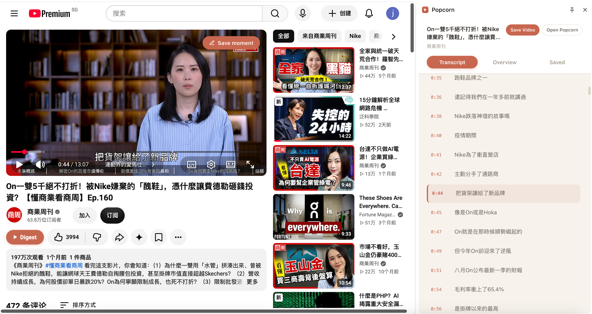
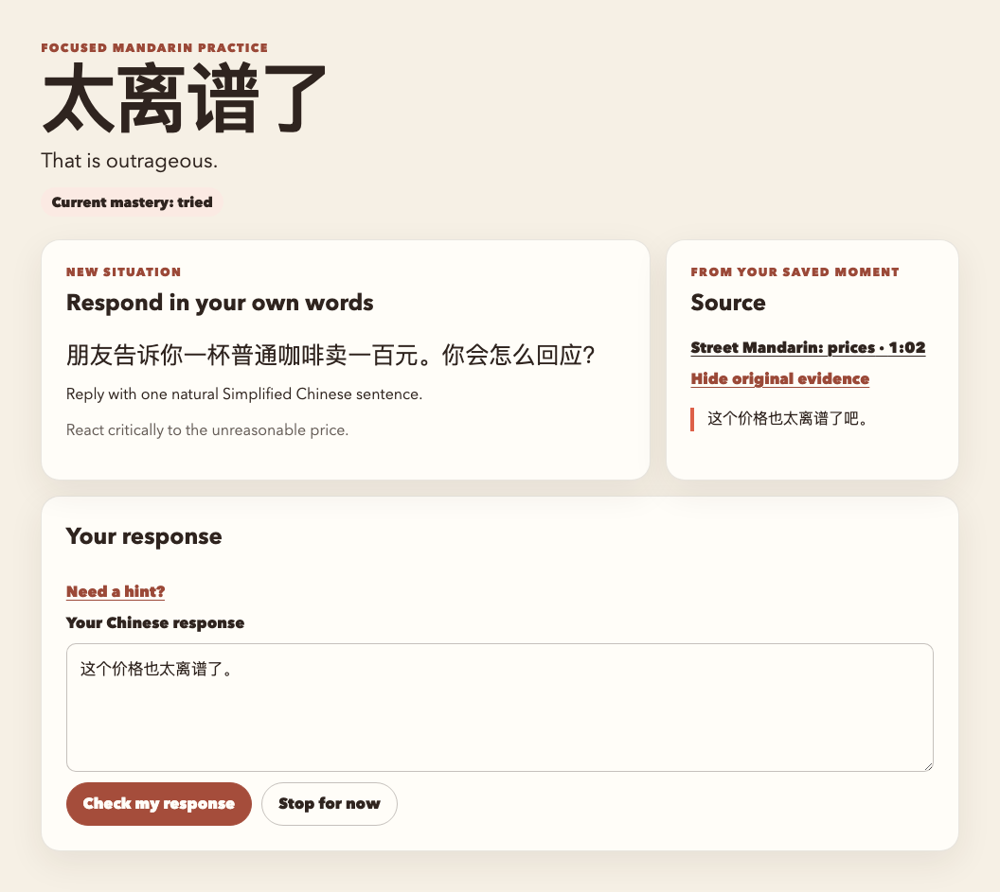
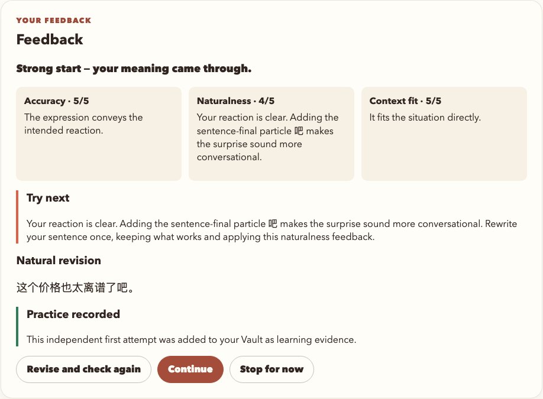
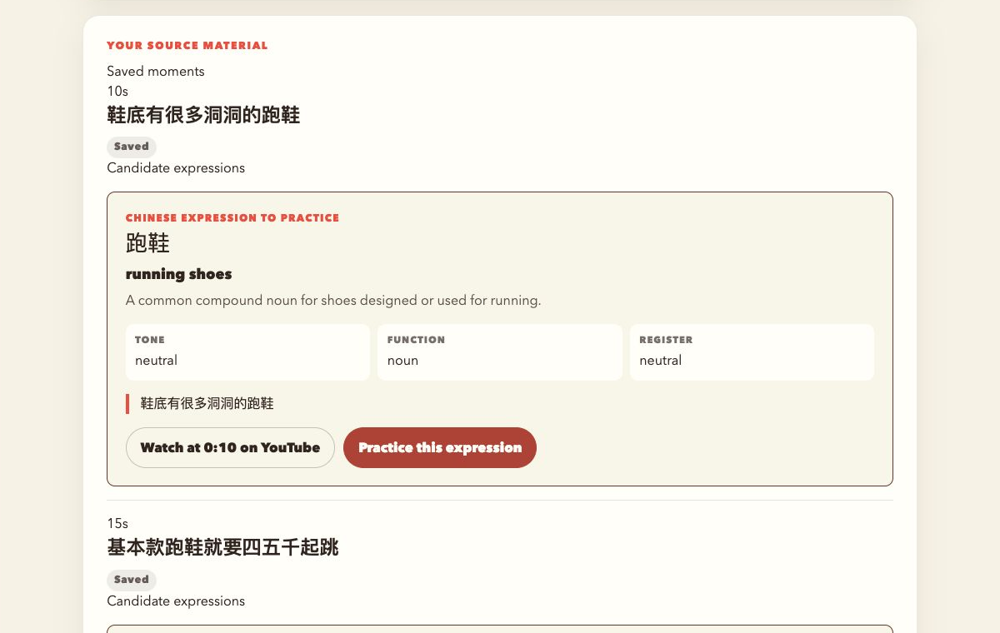
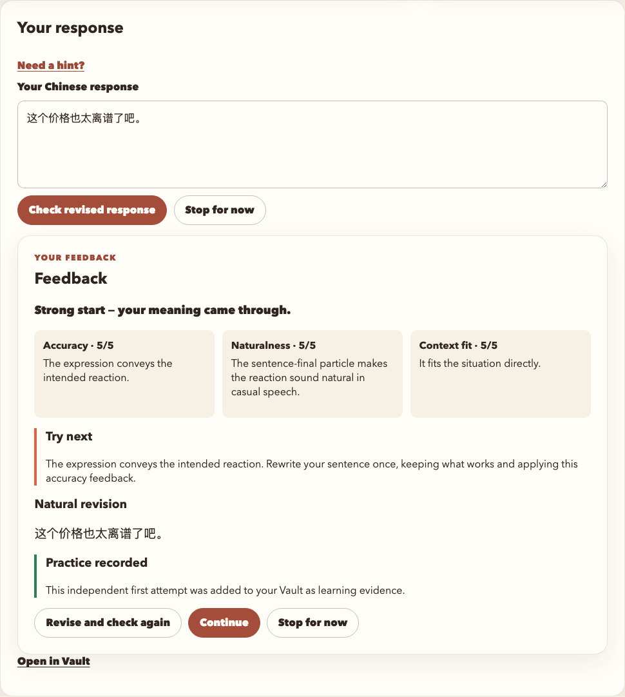
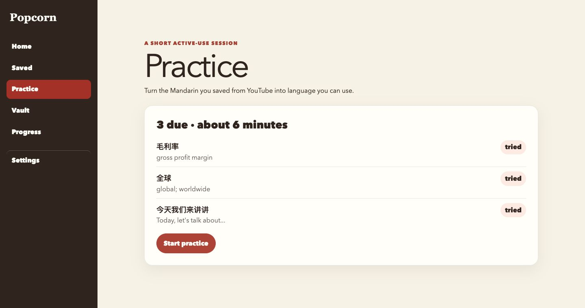
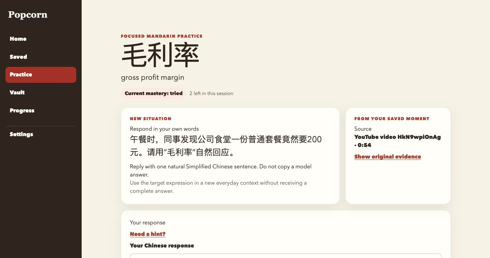
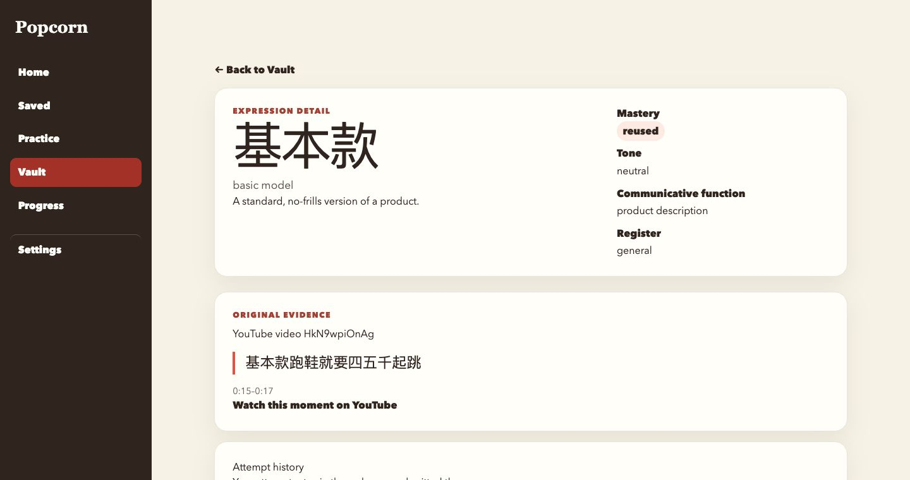
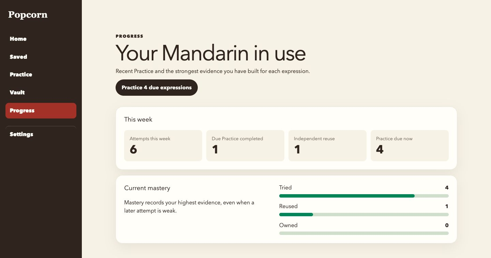

# Popcorn

**把 YouTube 中看懂的中文表达，变成自己能够使用的表达。**

Popcorn 是一款面向以英语为辅助语言的中级中文学习者的 AI 学习产品，由 Chrome 扩展与 Web 工作台组成：在观看中理解并保存感兴趣的表达，再通过原创回答、AI 反馈与后续复习，把素材连接到实际使用。

本项目为已实现的毕业设计，采用个人本地自托管方式运行。

[产品预览](#产品预览) · [技术选型](#技术选型) · [本地运行](#本地运行)

## 为什么做 Popcorn

**看懂一次，不代表下次能说出来。** 学习者可以借助字幕理解视频，却仍需要自己整理语境、设计练习，并判断收藏的表达是否真正用过。

Popcorn 聚焦这一断点：保留让表达产生意义的视频上下文，为它安排主动输出和后续复用，让学习进度有记录可查。

## 产品预览

**在 YouTube 理解与保存 → 从 Saved 完成首次练习 → 日后回到 Practice 复习 → 在 Vault / Progress 查看积累。**

截图展示实际使用场景与不同学习记录；固定数据的练习演示另作说明。点击图片可查看大图。

### 1. 看 YouTube 时：理解内容，留下想学的表达

打开侧栏查看中文、英文或双语字幕，按时间戳回到原句；按需生成视频概览、查看章节与关键句，或选段解释。遇到有用的内容，保存字幕行、选段或当前视频片段，继续观看。

[](docs/assets/readme/youtube-watching.png)

视频与字幕同屏呈现：边看边定位原句，通过 **Save moment** 保存当前片段，或用 **Save Video** 保存整条视频的学习快照。

### 2. 第一次练习：把收藏变成自己写出的一句话

从侧栏打开 Web，在 **Saved** 选择候选表达，点击 **Practice this expression**，进入“先作答、再反馈”的练习：

1. **用户输入**：面对“一杯普通咖啡卖一百元”的新场景，写下“这个价格也太离谱了。”，点击 **Check my response**。
2. **模型反馈**：界面分别展示准确性、自然度、语境适配的评分与解释，并提供改进重点和 **Natural revision** 示例。
3. **修改再试**：根据建议改为“这个价格也太离谱了吧。”，点击 **Check revised response** 再次检查。合格的独立首次尝试进入 **Vault** 成为 `tried` 证据；参考示范后的修改单独记录，不额外算作独立复用。

下方作答与反馈截图由项目实际前端组件加载固定演示数据生成，评分和反馈用于说明交互，非实时模型评测。

| 用户输入：新场景、原始来源与中文回答 | 反馈输出：三维评分、改进建议与自然改写 |
| :---: | :---: |
| [](docs/assets/readme/practice-input.png) | [](docs/assets/readme/practice-feedback.png) |

<details>
<summary>查看 Saved 练习入口与修改后再次检查的结果</summary>

| 从收藏的候选表达进入练习 | 修改回答后再次提交，查看更新反馈 |
| :---: | :---: |
| [](docs/assets/readme/saved-detail.png) | [](docs/assets/readme/practice-revision.png) |

</details>

### 3. 日后复习：换个场景再用一次，查看积累

再次打开产品时，从 **Home** 的下一步提示或 **Practice** 的到期列表开始。在新场景中重新作答、接收反馈，符合规则的独立复用推动掌握状态；**Vault** 保留来源与尝试历史，**Progress** 汇总练习、复用和当前掌握情况。

| 找到到期表达，开始短时复习 | 在新场景中重新使用，原始来源仍可查看 |
| :---: | :---: |
| [](docs/assets/readme/practice.png) | [](docs/assets/readme/practice-task.png) |

<details>
<summary>查看复习后的表达记录与学习进度</summary>

| Vault：回溯表达来源与练习记录 | Progress：查看练习与独立复用证据 |
| :---: | :---: |
| [](docs/assets/readme/vault-detail.png) | [](docs/assets/readme/progress.png) |

</details>

## 关键设计亮点

- **让理解自然衔接到输出**：字幕、翻译、概览和选段解释帮助理解；候选表达与练习承接下一步，原始来源始终可追溯。
- **收藏与掌握分开计算**：保存只记录兴趣；`tried → reused → owned` 按有效尝试及跨时间、场景的使用证据推进，避免用收藏量代替学习进展。
- **保留学习者的主动性**：练习先要求原创回答，再给反馈和示范，减少直接照抄 AI 答案的依赖。
- **让 AI 延迟不打断收藏**：先持久化原始内容，再后台生成学习材料；任务可恢复，重复提交避免产生重复记录。

### AI 在哪里创造价值

AI 负责翻译、概览、语境解释、候选表达、练习生成与反馈。系统保留来源、校验生成内容，并依据可信的作答记录更新进度；模型输出不会直接成为掌握状态。用户可在 Web 设置中配置自己的 OpenAI-compatible 模型服务。

## 技术选型

| 技术 | 承担的角色与选择理由 |
| --- | --- |
| **Next.js 16 + React 19 + TypeScript** | 在同一项目中承载 Web 交互与服务端 API，便于迭代完整链路；类型约束连接页面、接口和学习记录。 |
| **Chrome Extension · Manifest V3** | 通过 Side Panel 在观看现场提供帮助；Service Worker 管理会话与待同步事件，使捕获贴近用户当前任务。 |
| **Supabase · PostgreSQL / Auth / RLS** | 统一账号与关系数据管理，用事务、约束和行级权限维护来源、作答、复习之间的一致性及用户隔离。 |
| **PostgreSQL 持久任务队列 + Node.js worker** | 将慢速字幕与模型请求移出即时操作，记录任务状态、重试和完成结果，支持进程中断后的恢复。 |
| **Supadata + OpenAI-compatible 网关 + Zod** | 分离字幕获取与模型生成；服务端规范化、校验 AI 输出后再保存，兼顾模型选择与数据可靠性。 |
| **Vitest + Playwright** | 覆盖业务规则、API 契约、集成与浏览器链路；自动化使用固定数据，真实服务另做验证。 |

## 验证与边界

已实现从视频捕获到后续练习与进度记录的完整链路，验证记录覆盖数据库权限、幂等保存、任务恢复、扩展及 Web 体验，详见[执行与验收记录](docs/engineering/execution-ledger.md)。

当前聚焦支持原生简体中文字幕的 YouTube 视频。工程验证支持功能与可靠性判断；长期学习效果仍需用户研究验证，后续可关注收藏到首次练习转化、复习完成及独立复用情况。

## 本地运行

### 首次安装

需要 Node.js 24.5+、pnpm 11.19.0、Docker 和 Chrome 116+。

```bash
git clone https://github.com/LLLJJJcon/popcorn.git
cd popcorn
pnpm install --frozen-lockfile
```

随后按[中文使用指南](docs/operations/user-guide.zh-CN.md)或 [English self-host guide](docs/operations/local-self-host.md) 完成一次性配置：

1. 启动本地 Supabase，将 `.env.example` 复制为 `.env.local`，填写本地配置及 Supadata Key（从 [Supadata dashboard](https://dash.supadata.ai/) 获取，参阅[官方文档](https://docs.supadata.ai/)）。
2. 按指南初始化数据库、创建本地账号，生成并加载未打包扩展。
3. 在已登录的 Web 设置中填写模型服务名称、HTTPS API 根地址、模型 ID 与 API Key。地址必须为公开 HTTPS DNS 地址，不接受 IP、内部主机名、端口、凭证、查询参数或片段。

### 日常启停

完成首次配置后：

```bash
pnpm popcorn:start
pnpm popcorn:stop
```

macOS 也可双击 `Start Popcorn.command` / `Stop Popcorn.command`。详细手动启动与排障步骤见上述指南；`pnpm db:reset` 会清空本地数据，不用于日常启动。

模型 Key 只在已登录的 Web 设置中输入；`.env.local`、Supadata/模型密钥、密码和 Token 不应提交到 Git 或粘贴到聊天中。

相关文档：[扩展安装](docs/operations/extension-install.md) · [任务与保存恢复](docs/operations/job-recovery.md) · [账号重置](docs/operations/account-reset.md)

## 开源与致谢

项目采用 [MIT License](LICENSE)。扩展基于 [YouTube Digest](https://github.com/zarazhangrui/youtube-digest) 的部分能力开发，并保留原作者署名与许可证；复用范围见 [Upstream record](extension/UPSTREAM.md) 与 [Third-party notices](THIRD_PARTY_NOTICES.md)。
