# Popcorn

**Turn Mandarin you understand on YouTube into Mandarin you can use.**

A **Chrome extension + web workspace** for intermediate Mandarin learners whose first language is English: save expressions from videos you enjoy, learn how they work, and practise using them in new situations.

Personal project · Product design and AI-assisted development · Locally self-hosted

**English** · [简体中文](README.zh-CN.md)

[User journey](#one-expression-through-the-product) · [AI design](#ai-design) · [Product decisions](#product-decisions) · [Architecture](#architecture) · [Run locally](#run-locally)

[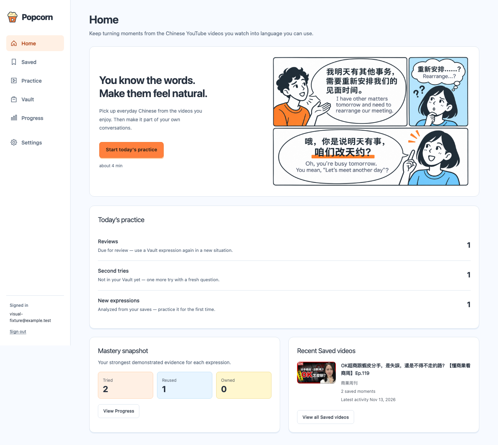](docs/assets/readme/home-current.png)

*Desktop Web · orange, sky blue and lemon. Records below are isolated visual fixtures.*

## The problem and the entry point

Intermediate learners can already communicate basic ideas and follow familiar Chinese content. Their next challenge is **choosing a natural everyday expression**, even when they recognise it in a video.

| A casual recommendation | A more conversational choice |
| --- | --- |
| 我认为他是一个可以信任的人。<br>“I think he is someone I can trust.” | 他挺靠谱的。<br>“He’s pretty dependable.” |

Both convey trust; the difference is expression choice in this setting.

**Why YouTube?** For learners who already watch Chinese videos, interest and context are already present. Popcorn lets them save a useful moment and continue watching, then decide later when to study. Its focus is the connection from **self-chosen content to a personal response and later reuse**.

## One expression through the product

*Illustrative user story: a learner notices 挺靠谱 (“pretty dependable”) and wants to use it themselves.*

```mermaid
%%{init: {"theme":"base","themeVariables":{"fontFamily":"system-ui, sans-serif","primaryColor":"#E8F5FF","primaryTextColor":"#27313F","primaryBorderColor":"#9CCFF3","lineColor":"#8299AD","secondaryColor":"#FFF0E4","tertiaryColor":"#FFF7CF"}}}%%
flowchart LR
    A["Watch & save"] --> B["Choose an expression"]
    B --> C["Learn its use"]
    C --> D["Respond in a new situation"]
    D --> E["Return for review"]
    classDef action fill:#FF803D,stroke:#EB6F29,color:#362618,stroke-width:2px
    classDef learn fill:#E8F5FF,stroke:#8DC9F2,color:#27313F,stroke-width:1.5px
    classDef evidence fill:#FFF7CF,stroke:#E9CA64,color:#64501D,stroke-width:1.5px
    linkStyle default stroke:#8299AD,stroke-width:2px
    class A action
    class B,C,D learn
    class E evidence
```

### 1. Save now, keep watching

Timestamped Chinese / English subtitles and optional explanations support comprehension. Save a moment, line or passage with its source context; open it later in **Saved**. Original content is stored before slower background enrichment. Saving a video keeps a learning snapshot, not a video download.

| Compact transcript | Four-part explanation | Saved videos |
| :---: | :---: | :---: |
| [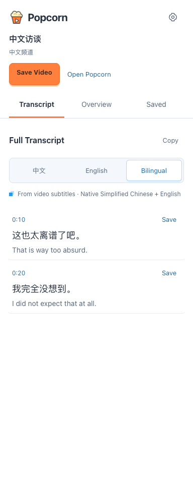](docs/assets/readme/extension-transcript-compact.png) | [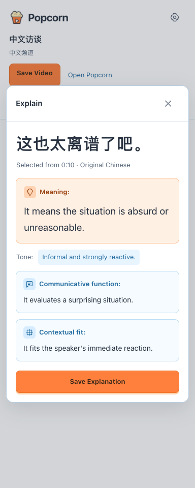](docs/assets/readme/extension-explanation-current.png) | [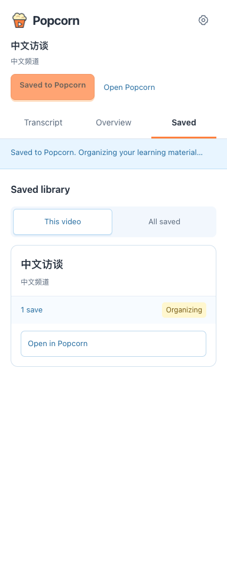](docs/assets/readme/extension-saved-current.png) |

*Actual unpacked Chrome-extension UI, captured in an isolated browser with mocked learning records. The extension uses the same orange, sky blue and lemon palette as Web.*

The latest transcript layout places the timestamp and Save on one row and reduces the spacing around each subtitle. At 384px wide, the same short Chinese fixture row is about 78px high (previously 150px); longer subtitles wrap naturally.

<details>
<summary>See the compact Chinese-only transcript</summary>

<p align="center"><a href="docs/assets/readme/extension-transcript-chinese-compact.png"></a></p>

</details>

<details>
<summary>Extension overview, account settings and recovery</summary>

Overview retains chapters, key quotes and their Save / Copy actions. Account settings remain separate from Web login. Expired sessions offer explicit sign-in; reconnecting the same account preserves queued moments and the original explanation selection. A stale extension connection asks you to reload the YouTube tab.

| Overview | Account settings | Explanation recovery |
| :---: | :---: | :---: |
| [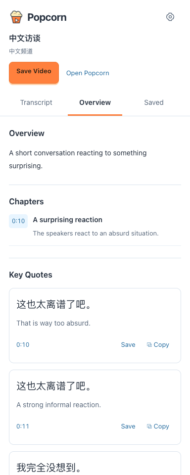](docs/assets/readme/extension-overview-current.png) | [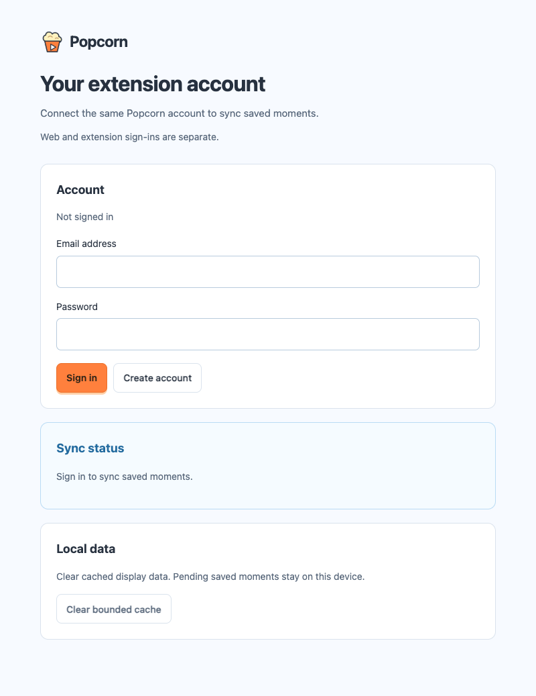](docs/assets/readme/extension-settings-current.png) | [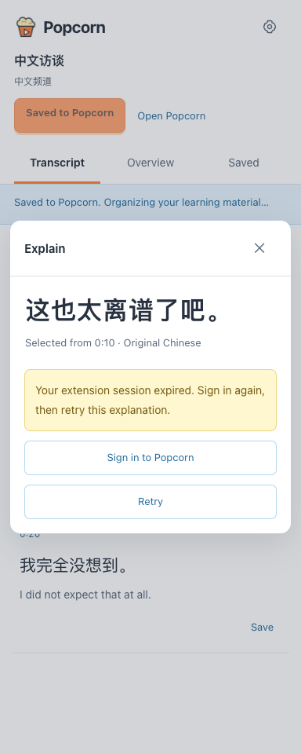](docs/assets/readme/extension-explanation-recovery-current.png) |

</details>

### 2. Choose what to learn, then understand how to use it

AI suggests useful spans for supported saves. The learner can remove or adjust suggestions, mark other words in the original text, then select **Analyze**. Saved highlights remain visible on unselected sentences.

[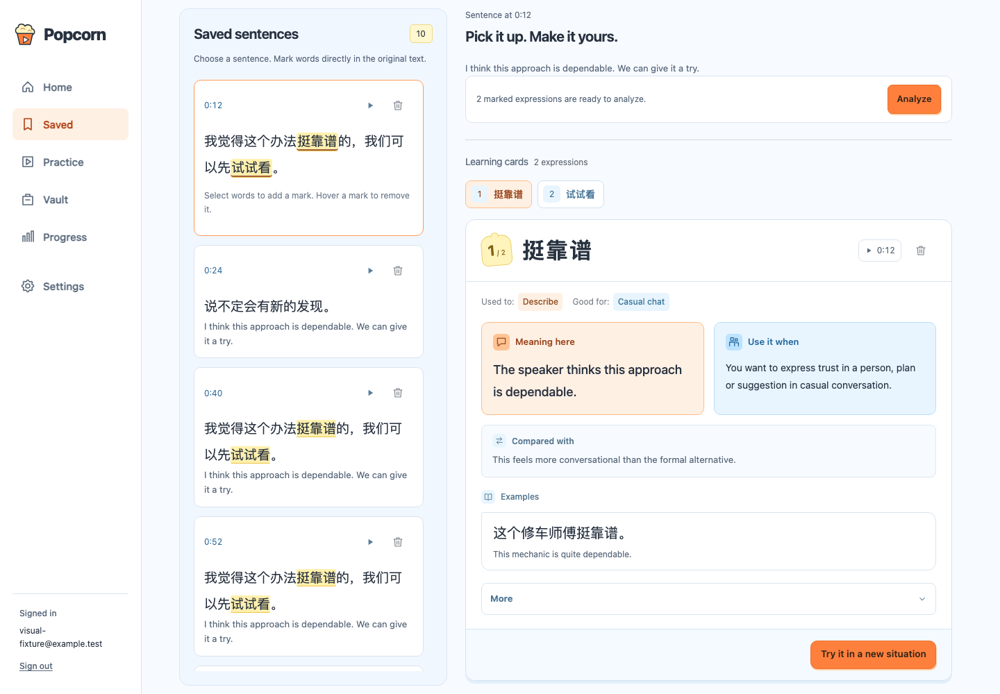](docs/assets/readme/saved-workspace-current.png)

The navigation stays fixed. First scroll the source information away; the learning workspace then fills the right side of the screen, with independent sentence and card scrolling. Scroll back up at a column’s start to return to the video information.

<p align="center"><a href="docs/assets/readme/learning-card-current.png">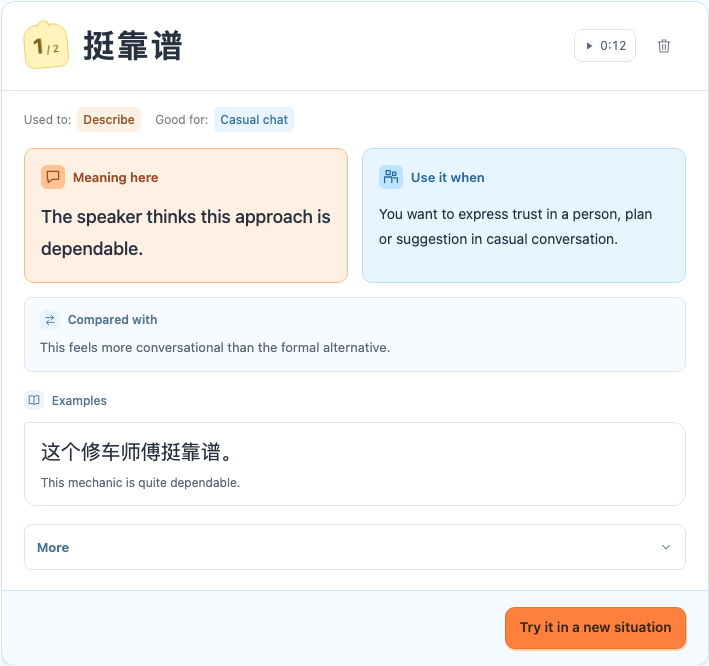</a></p>

*The example card and scenario illustrate the interface; they are not a live model evaluation.*

| Card content | The learner’s question |
| --- | --- |
| **Meaning here / Use it when** | What does it mean here, and when would I choose it? |
| **Compared with / Examples** | How does it differ from familiar wording? How does it work in a sentence? |
| **More** | How does it fit? Who can I say it to? Is there a real usage pitfall? |
| **Used to / Good for** | What intention and setting should later practice use? |

<details>
<summary>See the learning card with More expanded</summary>

The same **挺靠谱** fixture shows sentence placement, tone and the caution that confidence is not a guarantee.

<p align="center"><a href="docs/assets/readme/learning-card-more-current.png">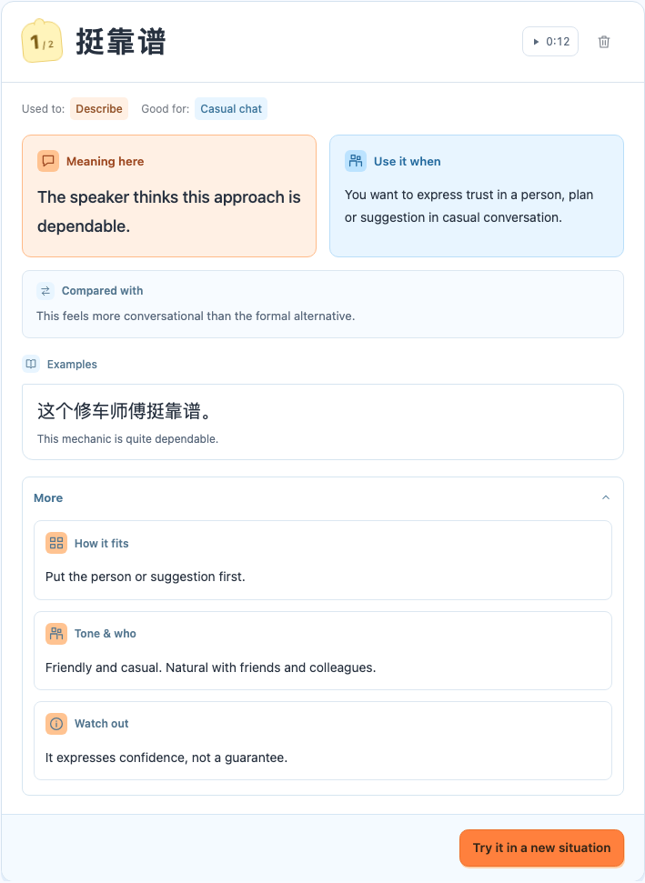</a></p>

</details>

### 3. Write a response before reading feedback

For 挺靠谱, a new task asks the learner to respond to a friend’s recommendation of a mechanic. The learner writes their own Chinese response, then receives separate scores and explanations for **meaning, naturalness and contextual fit**.

<p align="center"><a href="docs/assets/readme/practice-current.png">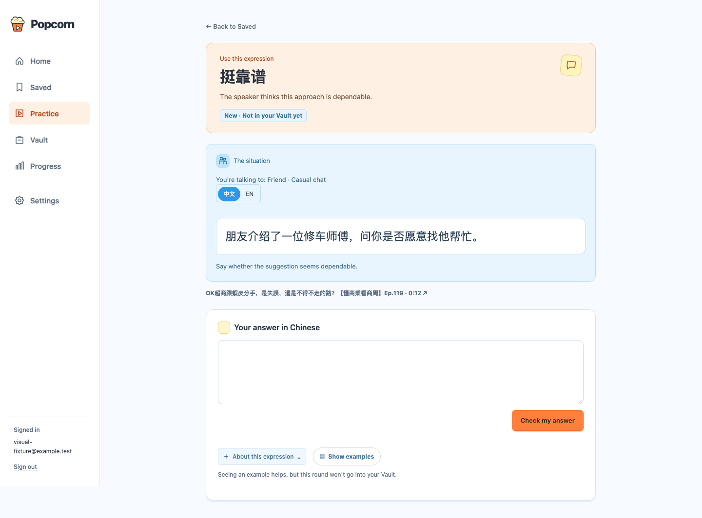</a></p>

*An illustrative first-answer result, rendered by the current feedback component:*

[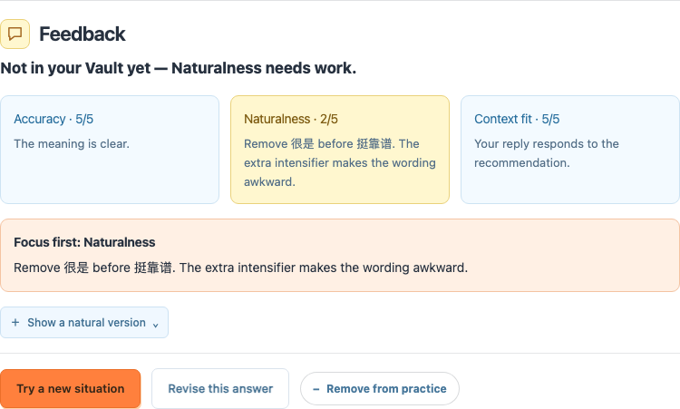](docs/assets/readme/feedback-panels-current.png)

*Fixed demo scores illustrate the layout only; the judgement rules are explained below.*

**Saved holds learning material; Vault holds expressions with qualifying use.** Improving the same answer remains useful practice, but entering Vault requires a qualifying first response in a new round. Opening a single card’s practice preserves its source return path and does not add formal-session controls.

### 4. Come back to use it again

Today’s session prioritises **Reviews → Second tries → New expressions**. Reviews start with the target expression hidden and introduce another situation.

| Evidence recorded | Mastery | Next review after success |
| --- | --- | --- |
| Qualifying first response | `tried` | 1 day |
| Independent success in a due review | `reused` | 7 days |
| Further qualifying use across 2+ contexts and 2+ UTC dates, including due practice | `owned` | 30 days |

These are software evidence states and fixed scheduling rules. Failed or example-assisted reviews return after one day without advancing mastery.

<details>
<summary>See the current practice queue</summary>

<p align="center"><a href="docs/assets/readme/today-practice-current.png">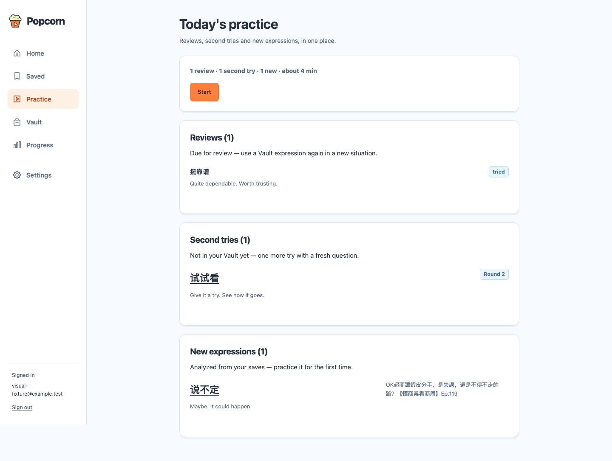</a></p>

| Near transfer | Far transfer |
| :---: | :---: |
| Keep the main intention and setting; change the topic. | Change to another suitable intention or setting; otherwise change topic and relationship. |

`tried` uses near transfer, `reused` uses far transfer, and `owned` alternates. The two review types follow the same evidence rules.

</details>

*Current Web screenshots render the real presentation components with isolated illustrative records. No personal account data or live model scores are used. Historical YouTube-extension captures are labelled in the [screenshot sources](docs/assets/readme/SCREENSHOTS.md).*

## AI design

**The learner chooses the expression. AI explains, generates and evaluates. Application rules control learning state.**

| Stage | Input → output | Design constraint |
| --- | --- | --- |
| **Suggest** | Saved target lines + context → 0–2 useful spans | Select only from target lines; prefer reusable language; allow no suggestion. |
| **Explain** | Confirmed spans + original context → learning cards | Keep the selected expression intact; explain its meaning here, tone and use. |
| **Generate a task** | Meaning + intention + setting + past situations → scenario, interlocutor and reply task | Change the topic; avoid repeated situations and target wording in the task. Card examples are excluded from generation input. |
| **Judge** | Target meaning + task + relationship + response → scores, reasons and optional minimal revision | Evaluate dimensions independently; ground deductions in a specific defect. |

### LLM as Judge: three separate questions

| Dimension | What it checks | Why it is separate |
| --- | --- | --- |
| **Accuracy** | Target meaning and semantic relations | Fluent Chinese can still reverse the intended meaning. |
| **Naturalness** | Wording, collocations and sentence construction | Correct meaning can still sound awkward. |
| **Context fit** | Communicative purpose, audience and setting | A correct sentence can still fail to answer the task. |

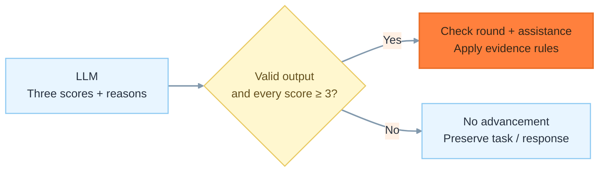

Passing scores alone do not establish independent use. Viewing examples records assistance; switching to English, reading usage notes or revealing a review expression does not. Revisions remain visible without rewriting the round’s formal result.

<details>
<summary>Scoring anchors and implementation references</summary>

| Score | Accuracy | Naturalness | Context fit |
| --- | --- | --- | --- |
| 1 | Target absent or core sense wrong | No determinate message | Off-task or opposite act |
| 2 | Core semantic relation wrong | Main grammar needs reconstruction | Primary purpose not achieved |
| 3 | Meaning recoverable, but a relation needs repair | Understandable with clear awkwardness | Primary purpose met, substantial mismatch remains |
| 4 | Minor semantic imprecision | Minor local wording defect | Slight supported tone / register mismatch |
| 5 | No semantic correction needed | No language correction needed | Task fulfilled appropriately |

Every score below 5 needs a concrete reason; a short, simple response can earn 5. These anchors guide the model; schema validation checks output structure, not the correctness of its judgement.

[Expression suggestions](src/server/ai/prompts/highlight-expressions.v1.ts) · [Learning cards](src/server/ai/prompts/analyze-saved-item.v3.ts) · [Task generation](src/server/ai/prompts/activate.v2.ts) · [Judge input](src/server/ai/prompts/evaluate.v2.ts) · [Full rubric](src/server/ai/prompts/evaluate.v1.ts)

</details>

## Product decisions

| Decision | Reason |
| --- | --- |
| **Separate watching from deliberate practice** | Preserve the existing viewing activity; let the learner choose when to study. |
| **Let learners edit AI suggestions** | Reduce discovery effort while keeping the learning choice with the user. |
| **Separate revision from independent reuse** | Distinguish improving one answer from using the expression in another situation. |
| **Keep state and retry when generation fails** | Generic scenes can miss an expression’s meaning or tone. Preserve the task or response instead of substituting an unsuitable template. |

**My role:** product definition and learning-flow design, using AI to assist software implementation and iteration. The decisions above translate the product goal into selection controls, generation constraints and explicit evidence rules. Parts of the extension adapt YouTube Digest, with attribution retained below.

## Architecture

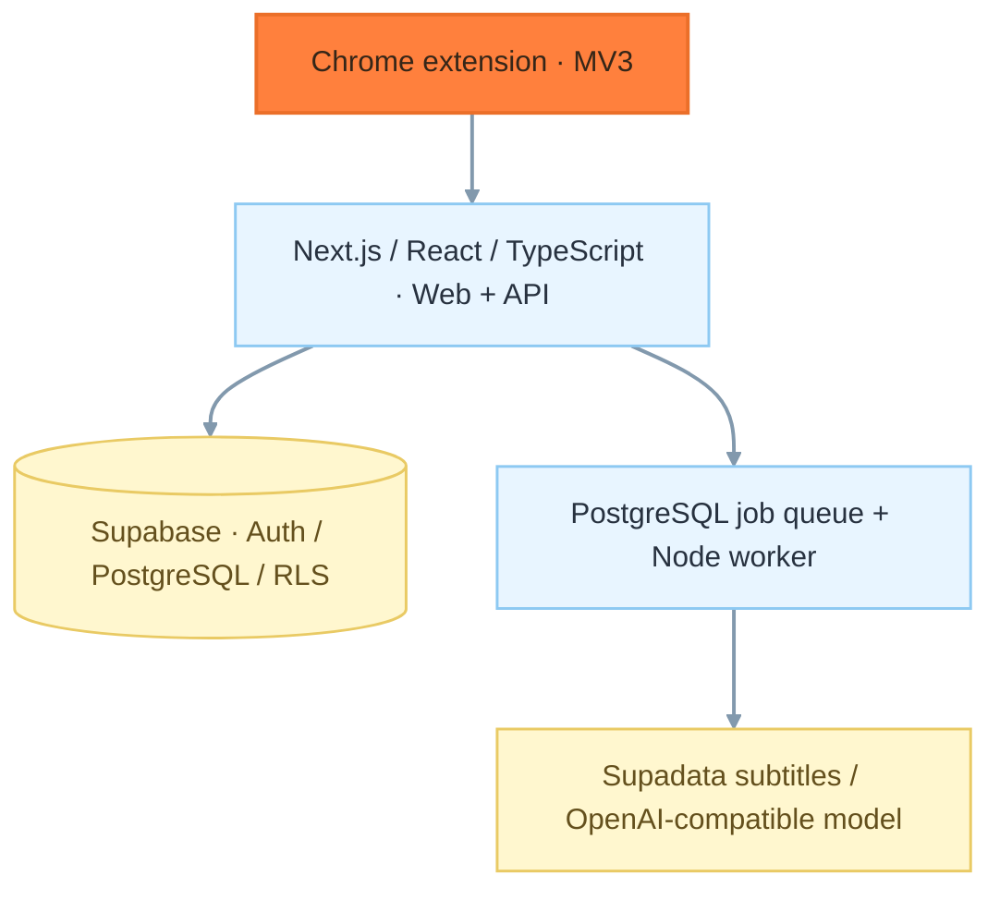

The side panel supports capture while watching. Web/API handles practice and state transitions. Auth and row-level security separate users; the durable queue retains slow work and retries. **Zod validates structured results; the server controls qualifying attempts, mastery and review dates.**

## Delivery and evidence

Implemented: expression selection and cards, practice rounds, daily sessions, near/far reviews, and existing Vault / Progress views. Current scope uses English support, typed Chinese responses and YouTube videos with native Simplified Chinese subtitles. The confirmed desktop redesign includes Home, Saved, Practice, feedback, Vault and Progress; voice practice remains outside scope.

| Expression evidence | Learning progress |
| :---: | :---: |
| [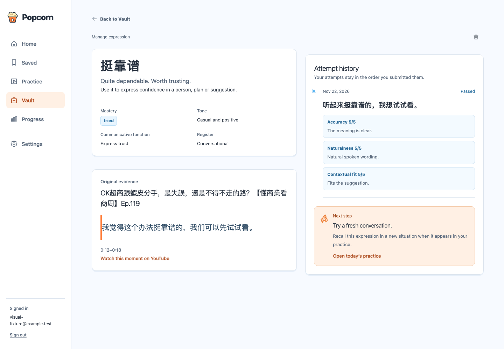](docs/assets/readme/vault-current.png) | [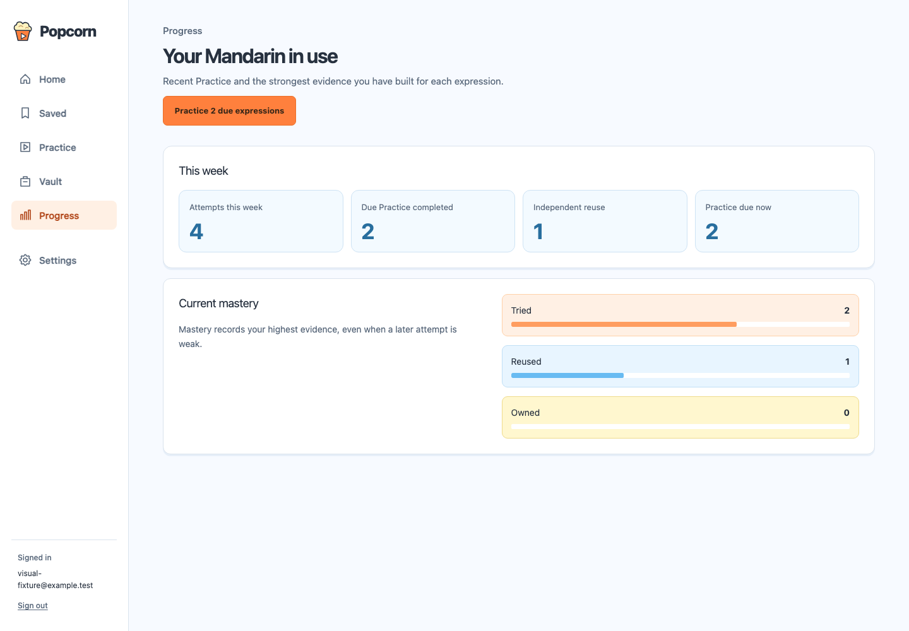](docs/assets/readme/progress-current.png) |

Recorded acceptance on **2 Nov 2026**: 1,833 application tests, 1,188 SQL assertions, 15 concurrency scenarios, 180 extension tests and 5 production browser workflows. Separately, 20 live-model review tasks passed individual human review. These are version-specific engineering and content checks, not measured learner improvement.

Extension refresh on **23 Nov 2026**: 204 extension tests and three isolated browser workflows passed, including reconnecting and retrying the same explanation. [Design and recovery verification](docs/engineering/2026-11-23-extension-ui-and-recovery.md).

[Engineering acceptance](https://github.com/LLLJJJcon/popcorn/blob/main/docs/engineering/group-4-main-integration-acceptance.md) · [Human review of generated tasks](https://github.com/LLLJJJcon/popcorn/blob/main/docs/engineering/prompt-runs/2026-11-01-transfer-scenario-v1-review-set.md)

## Run locally

Requires **Node.js 24.5+, pnpm 11.19.0, Docker and Chrome 116+**. Complete the one-time database, account, model and extension setup in the [English self-hosting guide](docs/operations/local-self-host.md) or [中文使用指南](docs/operations/user-guide.zh-CN.md).

```bash
git clone https://github.com/LLLJJJcon/popcorn.git
cd popcorn
pnpm install --frozen-lockfile
# After completing the one-time setup:
pnpm popcorn:start
pnpm popcorn:stop
```

Use your own OpenAI-compatible model service. Keep keys in the documented local configuration / signed-in settings. **`pnpm db:reset` erases local data; it is not a daily startup or upgrade command.**

[Extension installation](docs/operations/extension-install.md) · [Save / job recovery](docs/operations/job-recovery.md) · [Account reset](docs/operations/account-reset.md) · [Legacy record upgrades](https://github.com/LLLJJJcon/popcorn/blob/main/docs/superpowers/specs/2026-11-01-legacy-learning-card-upgrade-design.md)

## License and acknowledgments

[MIT License](LICENSE). Parts of the extension are based on [YouTube Digest](https://github.com/zarazhangrui/youtube-digest); see the [upstream record](extension/UPSTREAM.md) and [third-party notices](THIRD_PARTY_NOTICES.md).
