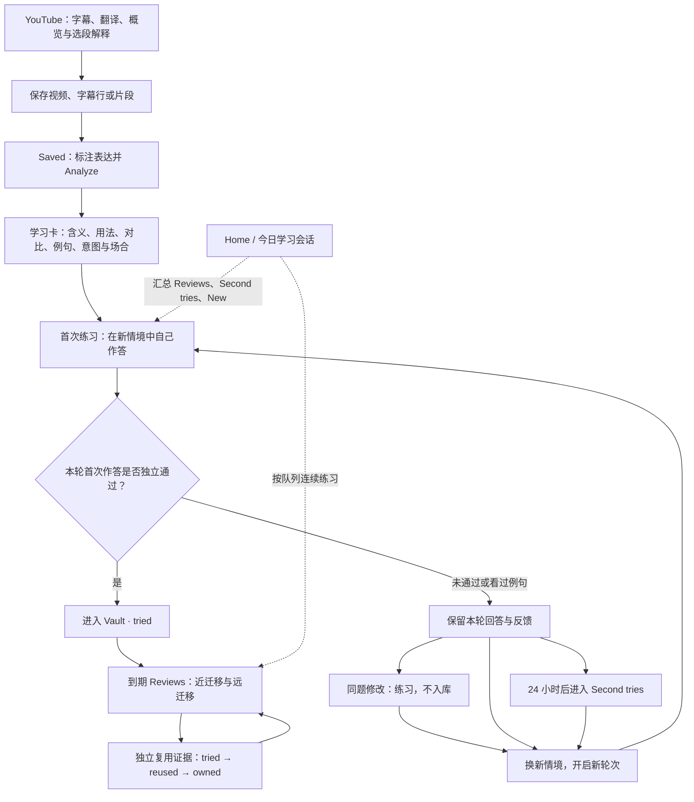

# Popcorn

**把 YouTube 中看懂的中文表达，变成自己能够使用的表达。**

Popcorn 面向以英语为辅助语言的中级中文学习者，由 **Chrome 扩展 + Web 学习工作台**组成。在视频中理解和保存真实语料，在 Saved 标注想学的表达、生成学习卡，再通过新情境作答、AI 反馈和间隔复习，留下自己的使用记录。

采用个人本地自托管方式运行，支持配置自己的 OpenAI-compatible 模型服务。

[学习流程](#学习流程) · [功能与界面](#功能与界面) · [技术选型](#技术选型) · [本地运行](#本地运行) · [验证与边界](#验证与边界)

## 为什么做 Popcorn

**看懂一次，不代表下次能说出来。** 字幕和翻译能帮助理解，却不能替学习者完成表达选择、主动输出和之后的复用。Popcorn 把这些步骤连接起来：每个表达保留原始语境，每次作答留下反馈，学习进展由独立使用的证据推动。

## 学习流程



保存、阅读学习卡和看反馈不会自动提升掌握度。**Saved 管想学的素材，Vault 管已经留下正式使用证据的表达**；改好同一道题是练习记录，换情境后的独立首次作答才可能建立新的有效证据。

## 功能与界面

下方扩展截图来自实际观看场景；新版 Web 截图来自当前一期代码的生产构建与隔离测试账号。Web 学习卡、题目、作答和评分均为固定演示数据，用于展示交互，**不代表实时模型生成质量或学习效果**。截图可点击放大，来源说明见[截图记录](docs/assets/readme/SCREENSHOTS.md)。

### 1. 在 YouTube 理解和保存

扩展在观看现场提供中文、英文或双语字幕，支持按时间戳定位原句；按需生成视频概览、章节和表达推荐，也可选中原文查看英语解释。可以保存整条视频的学习快照、当前时刻、字幕行或选段，之后在同账号 Web 的 Saved 查看。

[](docs/assets/readme/youtube-watching.png)

| Overview · 总结与章节导航 | Overview · 表达推荐 |
| :---: | :---: |
| [](docs/assets/readme/extension-overview.png) | [](docs/assets/readme/extension-overview-expressions.png) |

保存先落下原始内容，再由后台补齐字幕与学习材料；临时同步失败时扩展保留待同步内容并重试。**Save Video 保存来源和学习快照，不下载视频文件。**

### 2. 在 Saved 选择表达，生成可练习的学习卡

Saved 按视频整理保存的片段和原始语境。用户可以在原文中选中、标注想学的表达，也可调整自动标注；点击 **Analyze** 分析标注内容，逐条显示成功、处理中或失败状态，保留已成功的卡片。

学习卡回答的不只是“它是什么意思”，还包括“什么时候能这样说”：

| 内容 | 帮助解决的问题 |
| --- | --- |
| **Meaning here / Use it when** | 在这段视频里是什么意思？遇到什么情况可以使用？ |
| **Compared with** | 与近义说法相比，有什么区别？ |
| **Examples** | 两个中英例句，展示表达如何落进具体句子。 |
| **More：How it fits / Tone & who / Watch out** | 如何放进句子？适合对谁说？有哪些语气或用法限制？ |
| **Used to / Good for** | 交际意图与适用场合，供后续出题和评分使用。 |
| **来源时间戳** | 随时回到 YouTube 的原始语境。 |

[](docs/assets/readme/learning-cards.png)

人名、基础词等不适合当作可复用表达的内容会附上原因，可选择 **Practice anyway**，不会自动加入今日新表达。卡片按练习状态提供 **Practice this expression / Continue / In your Vault** 等入口。

### 3. 首次练习：自己作答，再看反馈

从 Saved 或今日新表达进入练习。题面按学习卡的交际意图和场合生成，包含对话对象、中文情境、可切换的英文说明与具体任务；来源时间链接始终保留。例如练“挺靠谱”，任务会让你在一个新场景中表达认可或信任。

- **提示分层**：About this expression 提供用法与语气；Show examples 显示例句并记录辅助。切换英文、查看 About 不算示范辅助。
- **三维反馈**：Accuracy、Naturalness、Context fit 分别给分并解释，指出优先改进处；可展开自然版本，逐字对照自己的回答。全满分时显示 Nothing to fix。
- **修改与新轮次分开**：保留首次回答、最新修改和首次反馈；同题修改不额外算独立复用。未入库时可继续修改、换一个新情境，或等待 Second try；不设练习轮次上限。
- **入库条件**：本轮首次作答独立通过后进入 Vault，成为 `tried`。看过例句或首次未通过的轮次不会靠反复修改入库，需在新情境中再次独立尝试；已作答但未入库、也未移除的表达，在重试时间到达后进入 Second tries（首次安排为 24 小时后）。
- **可以中断**：未发送的草稿在浏览器存储可用时自动保存，已提交的回答和反馈由服务端恢复。第一轮题目已生成但尚未作答，仍算 New，刷新继续同一道题。可 Remove from practice，并在 5 秒内 Undo。

<details>
<summary>查看首次练习的回答对照与反馈</summary>

[](docs/assets/readme/first-practice-feedback.png)

</details>

### 4. Home 与今日学习会话：打开就知道下一步

Home 汇总三类内容，与 Practice 使用同一套计数和分组；同时保留掌握度概览和最近保存的视频。主行动依次考虑：**配置模型 → 开始今日练习 → 分析待处理素材 → 去 YouTube 看视频**。

| 分组 | 收录什么 | 学习顺序 |
| --- | --- | --- |
| **Reviews** | Vault 中已到期的表达，在新情境中再次使用。 | 优先 |
| **Second tries** | 尚未入库、重试时间已到的表达。 | 其次 |
| **New expressions** | 已分析、尚未作答的可练习表达。 | 最后 |

点击 **Start** 连续完成今日会话，也可单独打开某一项。支持 Next / Finish / Exit、刷新恢复和会话结果汇总；每次前进都重新读取当前队列。不限制每日新表达数或会话总条数；新表达列表先展示 10 条，更多内容可用 **Show all** 展开。预计时长按每项 2 分钟估算。

| Home · 今日计数与下一步 | Practice · 三类完整队列 |
| :---: | :---: |
| [](docs/assets/readme/home.png) | [](docs/assets/readme/today-practice.png) |

### 5. 到期复习：隐藏表达，换场景再用一次

复习以学习卡的意图和场合生成题目，并避开已经使用过的情境：

- **近迁移**：保持主要交际意图和首选场合，检验能否在相近的新场景中复用。
- **远迁移**：优先切换次要意图或其他适用场合；没有可切换项时更换话题与对话对象。`tried` 使用近迁移，`reused` 使用远迁移，`owned` 交替练习。
- **先回想再求助**：目标中文表达默认遮蔽。Show the expression 可揭示表达，本身不算示范辅助；Show examples 会记录辅助，本次复习不推进掌握度。
- **提交前可换题**：每次复习允许成功更换情境一次；更换失败保留原题和换题次数。已准备好的题目直接复用。
- **正式结果与修改分开**：首次提交决定本次正式记录、掌握变化和后续排程；之后可修改并看反馈，但不重写正式作答，也不再次改变掌握度或排程。

| 近迁移 · 相近场合中的独立回想 | 远迁移 · 更换使用场合 |
| :---: | :---: |
| [](docs/assets/readme/review-near.png) | [](docs/assets/readme/review-far.png) |

首次练习与复习都提供失败恢复：出题失败显示 **Try again** 并保留状态，评分失败保留回答。生产环境不使用通用模板兜底，也不把失败输出当作已完成练习。

### 6. Vault、Progress 与资料管理

**Vault** 按表达保存来源、当前掌握状态和练习历史，并提供检索；**Progress** 汇总正式作答、复习完成、独立复用和掌握分布。`tried → reused → owned` 由有效独立作答及跨日期、情境的复用证据推进，复习沿用 1 / 7 / 30 天的间隔规则。

不同删除入口分别管理素材和学习记录，确认弹窗会说明影响：

| 操作 | 结果 |
| --- | --- |
| **删除 Saved 学习卡** | 从 Saved 隐藏这张卡；保留原句、Vault 和练习历史。 |
| **删除 Saved 片段** | 从 Saved 移除该条素材；保留练习历史、掌握度和复习。 |
| **删除 Saved 视频来源** | 删除保存的片段与来源内容；已练表达的 Vault、作答、掌握度和复习保留，但来源链接、时间戳和原文证据会移除。 |
| **删除 Vault 表达** | 从 Vault 移除并取消后续复习；保留过往练习历史和 Saved 来源。已完成复习仍可查看，不再提供新的修改入口。 |

旧记录保留原题与作答版本。缺少新版学习卡的记录可通过显式维护工具按原来源补齐，之后的新题使用新版路径；升级不改写旧题、作答、掌握度或排程。操作约束与验收见[旧记录升级方案](docs/superpowers/specs/2026-11-01-legacy-learning-card-upgrade-design.md)。

## 技术选型

| 技术 | 承担的角色 |
| --- | --- |
| **Next.js 16 + React 19 + TypeScript** | Web 页面、服务端 API 与共享类型。 |
| **Chrome Extension · Manifest V3** | YouTube 侧栏、现场捕获、扩展会话与待同步队列。 |
| **Supabase · PostgreSQL / Auth / RLS** | 账号、来源、学习卡、作答、复习与用户隔离；事务约束维护正式学习记录。 |
| **PostgreSQL 持久任务队列 + Node.js worker** | 后台处理字幕与模型请求，保存状态、重试及完成结果，支持中断恢复。 |
| **Supadata + OpenAI-compatible 网关 + Zod** | 字幕获取、可配置模型服务与结构化输出校验。 |
| **Vitest + Playwright + SQL 测试** | 业务规则、接口契约、集成、权限、真实并发与浏览器链路验证。 |

模型负责翻译、概览、解释、学习卡、出题和反馈；程序负责来源校验、独立性判定、幂等提交、掌握度与排程。**模型分数不会直接覆盖学习状态。**

## 本地运行

### 首次安装

需要 Node.js 24.5+、pnpm 11.19.0、Docker 和 Chrome 116+。

```bash
git clone https://github.com/LLLJJJcon/popcorn.git
cd popcorn
pnpm install --frozen-lockfile
```

随后按[中文使用指南](docs/operations/user-guide.zh-CN.md)或 [English self-host guide](docs/operations/local-self-host.md) 完成一次性配置：

1. 启动本地 Supabase，将 `.env.example` 复制为 `.env.local`，填写本地配置及 Supadata Key（从 [Supadata dashboard](https://dash.supadata.ai/) 获取）。
2. 按指南初始化数据库、创建本地账号，生成并加载未打包扩展。
3. 在已登录的 Web 设置中填写模型服务名称、HTTPS API 根地址、模型 ID 与 API Key。地址必须为公开 HTTPS DNS 地址，不接受 IP、内部主机名、端口、凭证、查询参数或片段。

### 日常启停

完成首次配置后：

```bash
pnpm popcorn:start
pnpm popcorn:stop
```

macOS 也可双击 `Start Popcorn.command` / `Stop Popcorn.command`。手动启动与排障见上述指南；**`pnpm db:reset` 会清空本地数据，不用于日常启动或已有数据升级。** 已有部署更新前应备份数据，并按迁移与升级方案操作。

模型 Key 只在已登录的 Web 设置中输入；`.env.local`、Supadata/模型密钥、密码和 Token 不应提交到 Git 或粘贴到聊天中。

相关文档：[扩展安装](docs/operations/extension-install.md) · [任务与保存恢复](docs/operations/job-recovery.md) · [账号重置](docs/operations/account-reset.md)

## 验证与边界

当前已交付一期组 1–4：**表达标注与学习卡、分轮首次练习、今日会话与 Home、新版到期复习**，并完成旧记录升级及资料移除兼容处理。二期的扩展回流、Vault / Progress 新版设计不属于本次已交付功能。

截至 2026-11-02，独立验收记录包含：1833 项应用测试、1188 条 SQL 断言、15 组真实并发、180 项扩展测试和 5 条生产构建浏览器流程。真实模型的 20 道新版复习题另经人工逐题审核通过；固定数据测试与真实模型审核分别留档，详见[最终集成验收](docs/engineering/group-4-main-integration-acceptance.md)、[真实题目审阅](docs/engineering/prompt-runs/2026-11-01-transfer-scenario-v1-review-set.md)和[执行记录](docs/engineering/execution-ledger.md)。这些是已记录版本的验收结果，后续提交应重新运行相关检查。

```bash
pnpm verify          # lint、类型、应用测试、来源校验与生产构建
pnpm test:extension  # 扩展测试
pnpm db:test         # SQL 测试；先确认连接的是隔离测试数据库
pnpm test:e2e        # 浏览器测试；按测试配置准备隔离环境
```

当前聚焦支持原生简体中文字幕的 YouTube 视频，界面以英文辅助中文学习；语音练习、主动通知和游戏化尚未实现。工程验收验证功能和可靠性，长期学习效果仍需用户研究。

更早的[产品说明与 Agent 交接](docs/product/Popcorn产品完整说明与Agent交接.md)保留了历史版本的设计与代码导航；其中旧练习入口、轮次和候选分析规则应以当前 README、代码及一期验收为准。

## 开源与致谢

项目采用 [MIT License](LICENSE)。扩展基于 [YouTube Digest](https://github.com/zarazhangrui/youtube-digest) 的部分能力开发，并保留原作者署名与许可证；复用范围见 [Upstream record](extension/UPSTREAM.md) 与 [Third-party notices](THIRD_PARTY_NOTICES.md)。
