# Popcorn

**把 YouTube 中看懂的中文表达，变成自己能够使用的表达。**

面向以英语为母语的中级中文学习者，通过 **Chrome 扩展 + Web 学习工作台**，保存感兴趣的视频表达，理解用法，再在新情境中练习使用。

个人项目 · 产品设计与 AI 辅助开发 · 本地自托管

[English](README.md) · **简体中文**

[用户链路](#一个表达如何走完整条链路) · [AI 能力设计](#ai-能力设计) · [关键产品决策](#关键产品决策) · [技术架构](#技术架构) · [本地运行](#本地运行)

[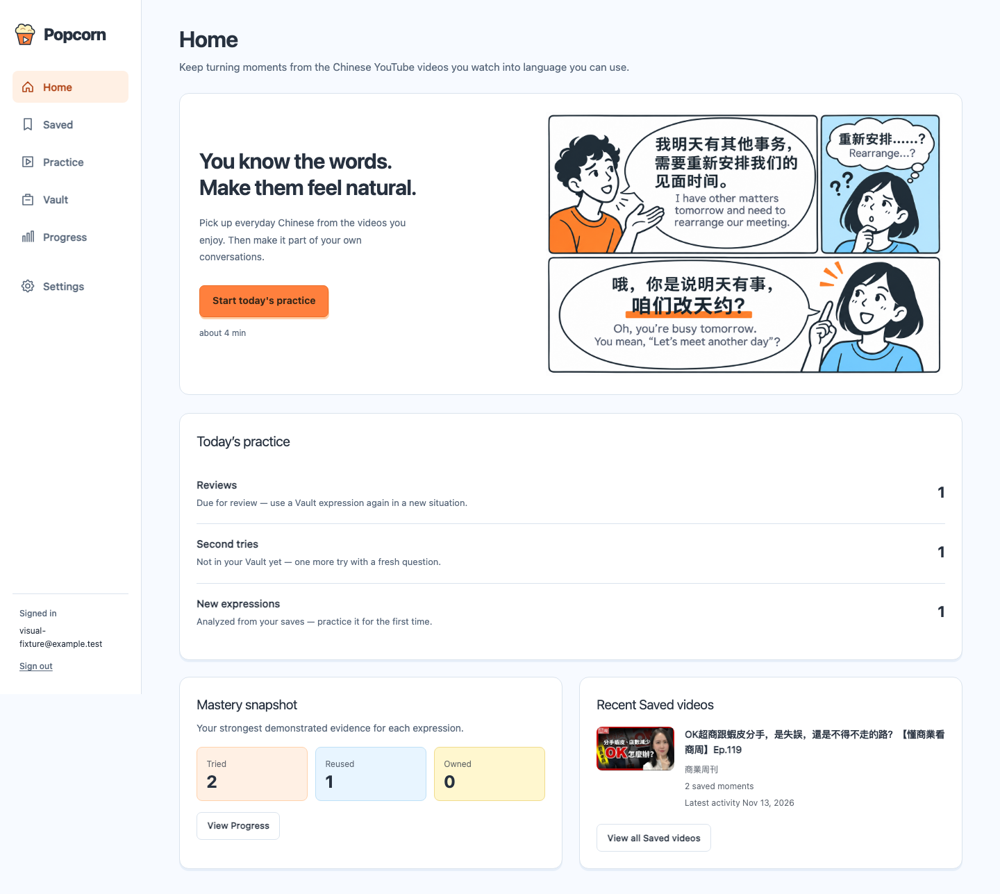](docs/assets/readme/home-current.png)

*桌面 Web · 橙、天蓝、柠檬黄。以下记录使用隔离的视觉示例数据。*

## 用户问题与切入点

中级学习者已经能进行基本沟通、阅读和听懂熟悉的中文内容。接下来的困难是：**即使在视频里看懂了地道说法，自己表达时仍容易依赖正式、复杂的句子。**

| 朋友聊天时的推荐 | 更日常的说法 |
| --- | --- |
| 我认为他是一个可以信任的人。 | 他挺靠谱的。 |

两句都能表达信任；这里的区别是特定场合下的表达选择。

**为什么选择 YouTube？** 对本来就观看中文视频的学习者，兴趣与语境已经存在。Popcorn 让用户轻量保存、继续观看，稍后再决定何时学习，重点连接**自主选择的内容、自己的新情境回答与后续复用**。

## 一个表达如何走完整条链路

*示例用户故事：学习者看到“挺靠谱”，希望以后自己也能用。*


### 1. 当下保存，继续观看

带时间戳的中英字幕与按需解释辅助理解。保存当前时刻、字幕行或片段及其来源语境，之后在 **Saved** 中查看；原始内容先保存，较慢的补全任务在后台进行。保存视频保留学习快照，不下载视频文件。

| 紧凑字幕 | 四项解释 | 已保存视频 |
| :---: | :---: | :---: |
| [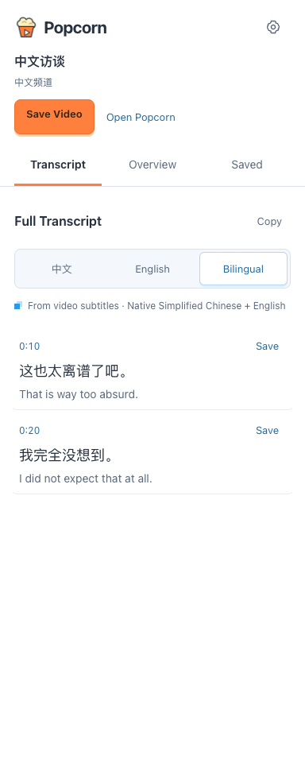](docs/assets/readme/extension-transcript-compact.png) | [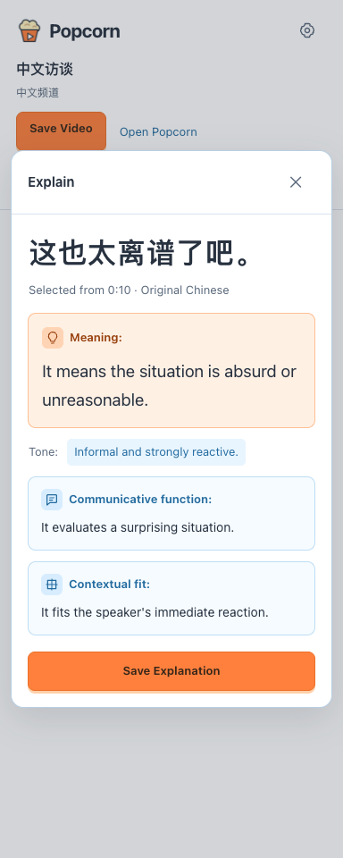](docs/assets/readme/extension-explanation-current.png) | [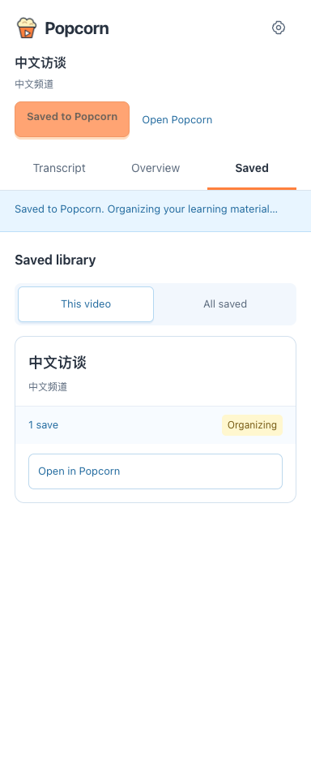](docs/assets/readme/extension-saved-current.png) |

*以上来自真实解压扩展，在隔离浏览器中使用模拟学习数据截图；与 Web 共用橙、天蓝、柠檬黄配色。*

最新字幕布局将时间戳与 Save 放在同一行，并缩小单条字幕的上下留白。384px 侧栏中，同一条短中文示例从约 150px 降到 78px；长字幕正常换行。

<details>
<summary>查看纯中文模式的紧凑字幕</summary>

<p align="center"><a href="docs/assets/readme/extension-transcript-chinese-compact.png"></a></p>

</details>

<details>
<summary>插件概览、账号设置与恢复</summary>

Overview 保留章节、引用及其 Save / Copy。插件账号设置独立于 Web 登录；会话过期后可以显式重新登录同一账号，保留待同步记录与原解释选区；旧插件连接失效时明确提示刷新 YouTube 页面。

| 概览 | 插件账号设置 | 解释恢复 |
| :---: | :---: | :---: |
| [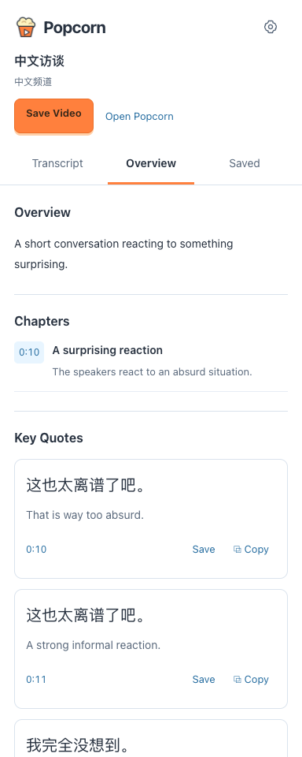](docs/assets/readme/extension-overview-current.png) | [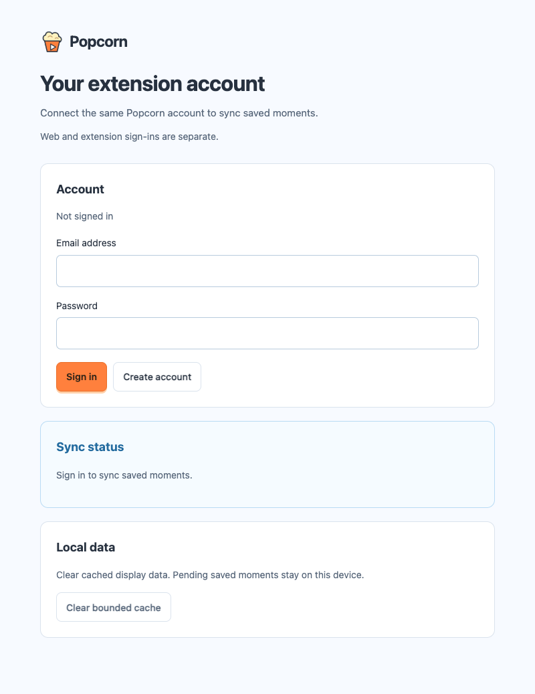](docs/assets/readme/extension-settings-current.png) | [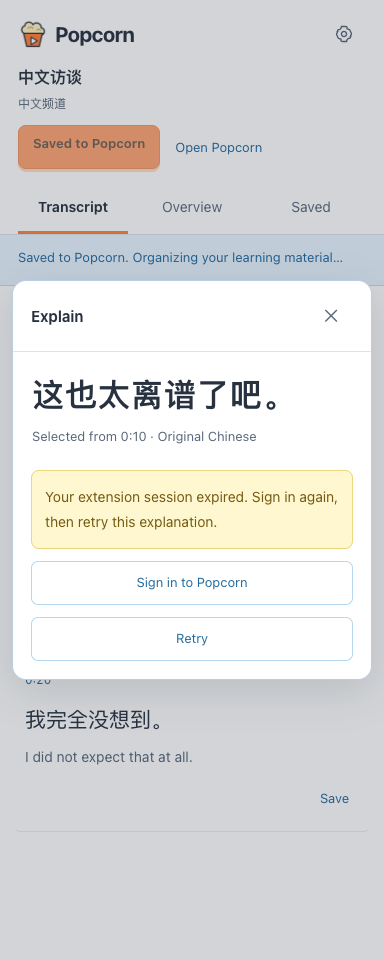](docs/assets/readme/extension-explanation-recovery-current.png) |

</details>

### 2. 自己选表达，再理解怎么用

对于支持自动建议的保存内容，AI 先推荐值得学习的片段。用户可以删除、调整建议，也可在原文中补选，再点击 **Analyze**。

[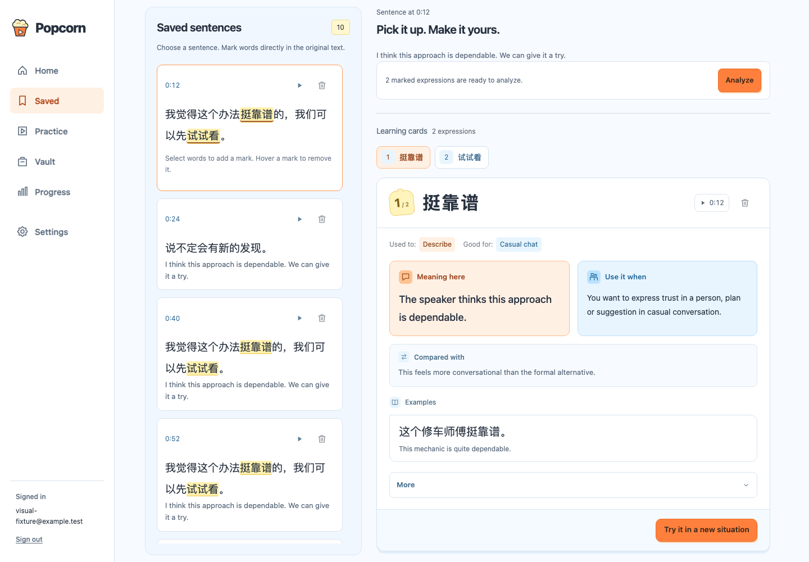](docs/assets/readme/saved-workspace-current.png)

导航固定；右侧先滚动至学习区铺满屏幕，再进入两栏独立滚动。未选中句子也显示词语高亮。

<p align="center"><a href="docs/assets/readme/learning-card-current.png">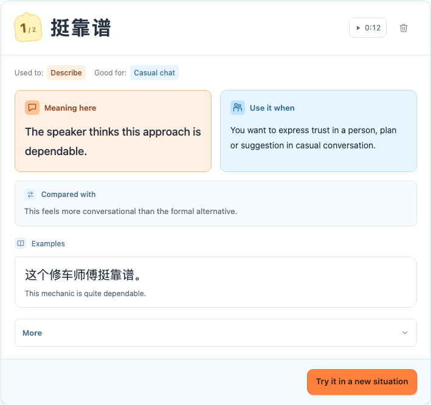</a></p>

*卡片与情境使用隔离示例数据，不代表实时模型评测结果。*

| 卡片内容 | 学习者要解决的问题 |
| --- | --- |
| **Meaning here / Use it when** | 在这里是什么意思？什么时候会选择这样说？ |
| **Compared with / Examples** | 与熟悉的说法差在哪？如何放进完整句子？ |
| **More** | 怎样接进句子？适合对谁说？有没有实际的用法陷阱？ |
| **Used to / Good for** | 后续练习应围绕什么交际意图和场合？ |

<details>
<summary>查看同一学习卡的 More 展开状态</summary>

下图使用同一“挺靠谱”示例，展示句式、语气与“信任不等于保证结果”的提醒。

<p align="center"><a href="docs/assets/readme/learning-card-more-current.png">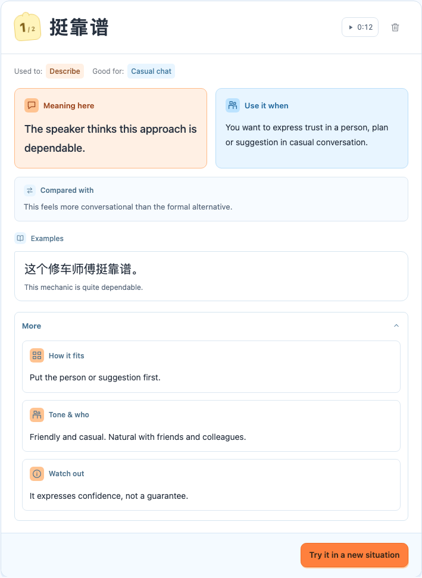</a></p>

</details>

### 3. 先自己回答，再看反馈

练习“挺靠谱”时，新任务让学习者回应朋友推荐修车师傅的情境。用户自己写中文回答，再分别获得**含义准确度、自然度与情境适配**的评分和解释。

<p align="center"><a href="docs/assets/readme/practice-current.png">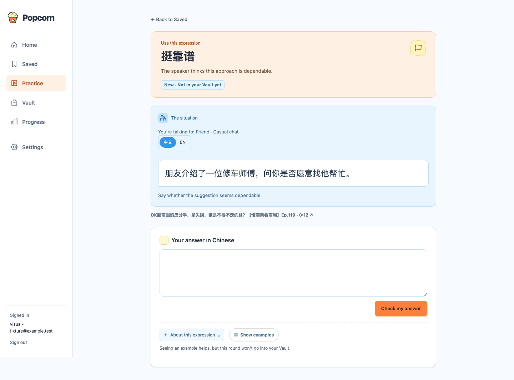</a></p>

*当前反馈组件展示的一次示例首次作答结果：*

[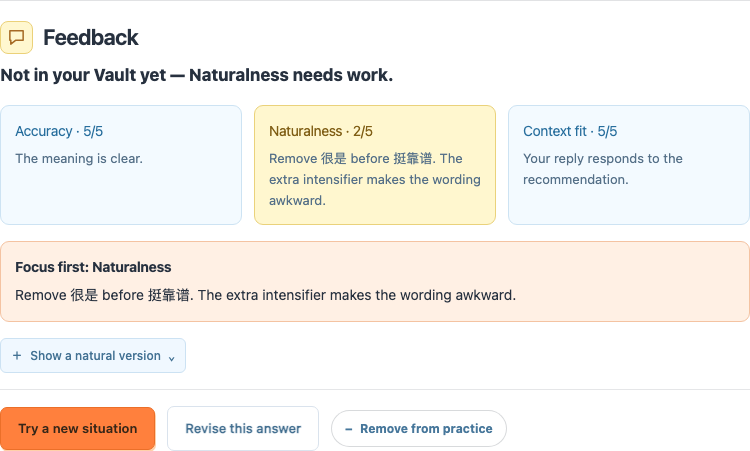](docs/assets/readme/feedback-panels-current.png)

*固定演示评分仅展示界面布局，评分判断规则见下文。*

**Saved 保存想学的素材，Vault 保存已有有效使用证据的表达。** 修改同一个回答仍有练习价值；进入 Vault 需要在新轮次中完成符合规则的首次作答。单次练习保留返回来源的入口，与正式复习会话分开。

### 4. 之后回来，换情境再用一次

今日会话按 **Reviews → Second tries → New expressions** 安排优先顺序。复习默认遮蔽目标表达，并换一个情境。

| 累积的使用证据 | 掌握状态 | 成功后的下次复习 |
| --- | --- | --- |
| 符合规则的首次作答 | `tried` | 1 天后 |
| 到期复习中独立成功复用 | `reused` | 7 天后 |
| 进一步有效使用，覆盖至少 2 个情境、2 个 UTC 日期，并包含到期练习 | `owned` | 30 天后 |

这些是程序定义的证据状态和固定排程规则。未通过或看过例句的复习，次日再安排，不推进掌握度。

<details>
<summary>查看新版今日练习队列</summary>

<p align="center"><a href="docs/assets/readme/today-practice-current.png">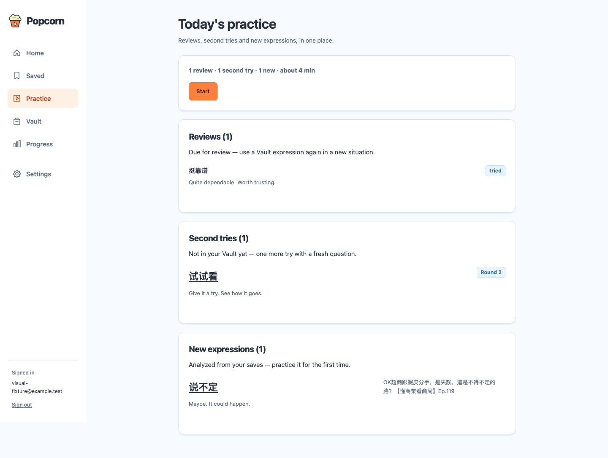</a></p>

| 近迁移 | 远迁移 |
| :---: | :---: |
| 保持主要意图和场合，更换话题。 | 切换其他适用意图或场合；没有可切换项时，更换话题与对话对象。 |

`tried` 使用近迁移，`reused` 使用远迁移，`owned` 交替使用。

</details>

*新版 Web 截图由正式界面组件和隔离示例数据渲染；卡片、作答与评分不代表实时模型结果或学习效果。扩展历史截图另作说明。[截图来源](docs/assets/readme/SCREENSHOTS.md)。*

## AI 能力设计

**用户决定学哪个表达；AI 负责解释、生成与评价；程序规则管理学习状态。**

| 环节 | 输入 → 输出 | 关键约束 |
| --- | --- | --- |
| **建议表达** | 保存的目标句及上下文 → 0–2 个可学片段 | 只从目标句选取，优先可复用表达；没有合适内容时允许为空。 |
| **生成学习卡** | 用户确认的标注及原语境 → 结构化学习卡 | 保留所选表达，解释此处含义、语气与使用条件。 |
| **生成新情境** | 含义、意图、场合及历史情境 → 场景、对象与回答任务 | 更换话题、避开重复，题面不泄露目标措辞；不传入学习卡例句。 |
| **评价作答** | 目标义、任务、关系与用户回答 → 评分、理由及可选的最小修改 | 各维独立判断，扣分需有具体问题作为依据。 |

### LLM as Judge：分别判断三个问题

| 维度 | 判断什么 | 为什么单独评 |
| --- | --- | --- |
| **Accuracy** | 目标含义与语义关系 | 句子流畅，也可能把意思说反。 |
| **Naturalness** | 措辞、搭配与句式 | 含义正确，也可能说得生硬。 |
| **Context fit** | 沟通目的、对象与场合 | 语言正确，也可能没有回应任务。 |

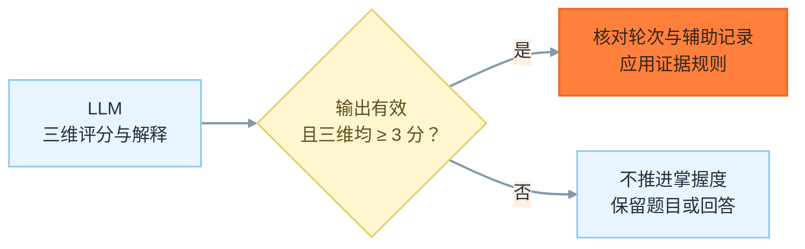

评分通过还需结合辅助记录与轮次，才能判断是否形成独立使用证据。看例句算辅助；切换英文、查看用法和揭示复习表达不算。修改记录保留，但不重写本轮正式结果。

<details>
<summary>评分锚点与实现依据</summary>

| 分数 | Accuracy | Naturalness | Context fit |
| --- | --- | --- | --- |
| 1 | 未使用目标表达或核心含义错误 | 无法恢复明确意思 | 偏题或执行相反的沟通行为 |
| 2 | 核心语义关系错误 | 需要重建主要语法关系 | 未完成主要沟通目的 |
| 3 | 含义可恢复，但关系需要修补 | 可理解，有明显不自然之处 | 主要目的达成，仍有明显不匹配 |
| 4 | 次要语义不精确 | 局部措辞问题 | 有依据的轻微语气或语体不匹配 |
| 5 | 无需语义纠正 | 无需语言纠正 | 恰当地完成任务 |

低于 5 分需说明具体问题；简短、普通的回答也可以得 5 分。锚点约束模型判断；结构校验检查输出格式，不保证判断本身正确。

[表达建议](src/server/ai/prompts/highlight-expressions.v1.ts) · [学习卡](src/server/ai/prompts/analyze-saved-item.v3.ts) · [出题](src/server/ai/prompts/activate.v2.ts) · [评分输入](src/server/ai/prompts/evaluate.v2.ts) · [完整评分标准](src/server/ai/prompts/evaluate.v1.ts)

</details>

## 关键产品决策

| 选择 | 原因 |
| --- | --- |
| **观看与专门练习分开** | 承接原有观看活动，让用户选择何时开始学习。 |
| **AI 建议可由用户调整** | 减少发现表达的负担，同时保留用户的学习选择权。 |
| **同题修改与独立复用分开** | 区分改好一个回答，以及在另一情境中使用表达。 |
| **生成失败时保留状态、允许重试** | 通用场景可能不适配表达含义或语气；保留题目或回答，避免用不合适的模板替代。 |

**我的角色：** 产品定义与学习链路设计，使用 AI 辅助软件实现和迭代。上述决策将产品目标落实为可调整的选择、生成约束与明确的证据规则。扩展部分能力基于 YouTube Digest 开发，复用范围见文末。

## 技术架构

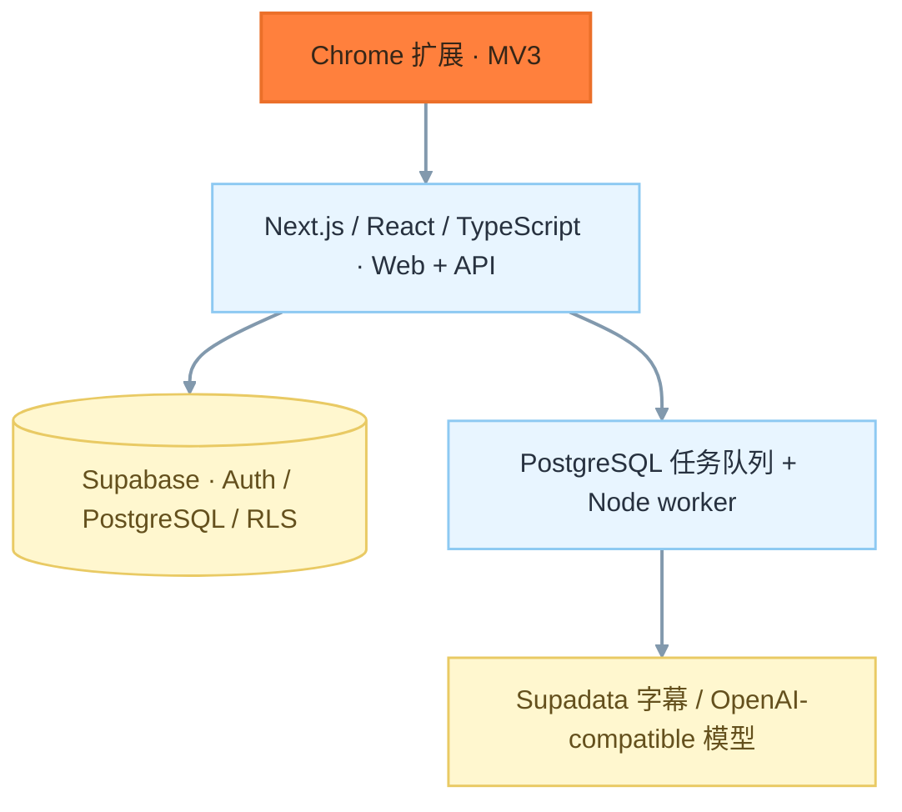

侧栏承接观看中的捕获，Web/API 管理练习与状态流转。认证与行级安全隔离用户，持久队列保存较慢任务并支持重试。**Zod 校验结构化结果，服务端决定有效作答、掌握度与复习时间。**

## 交付与验证

已实现表达选择与学习卡、分轮练习、今日会话、近远迁移复习，以及现有 Vault / Progress 页面。当前范围为英文辅助、中文文字作答，以及支持原生简体中文字幕的 YouTube 视频；本次桌面重设计已覆盖 Home、Saved、Practice、反馈、Vault 和 Progress，语音练习仍不在范围内。

**2026 年 11 月 2 日**的验收记录包含 1833 项应用测试、1188 条 SQL 断言、15 组并发场景、180 项扩展测试和 5 条生产构建浏览器链路；另有 20 道真实模型复习题经人工逐题审核。这些是特定版本的工程与内容检查，不是学习效果实验。

**2026 年 11 月 23 日**的插件更新通过 204 项扩展测试与三条隔离浏览器链路，覆盖重新登录后重试原解释。[设计与恢复验证](docs/engineering/2026-11-23-extension-ui-and-recovery.md)。

[工程验收](https://github.com/LLLJJJcon/popcorn/blob/main/docs/engineering/group-4-main-integration-acceptance.md) · [生成题目的人工审核](https://github.com/LLLJJJcon/popcorn/blob/main/docs/engineering/prompt-runs/2026-11-01-transfer-scenario-v1-review-set.md)

### 新版表达证据与学习进度

| Vault：来源与尝试历史 | Progress：学习证据 |
| :---: | :---: |
| [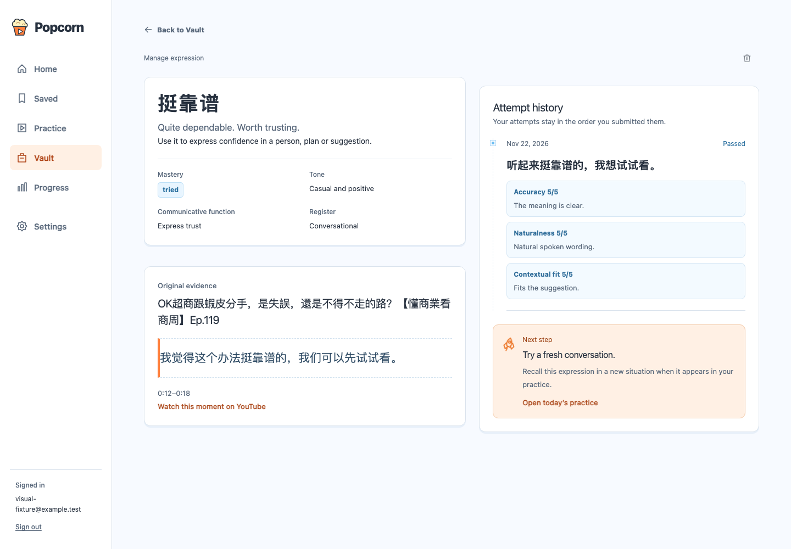](docs/assets/readme/vault-current.png) | [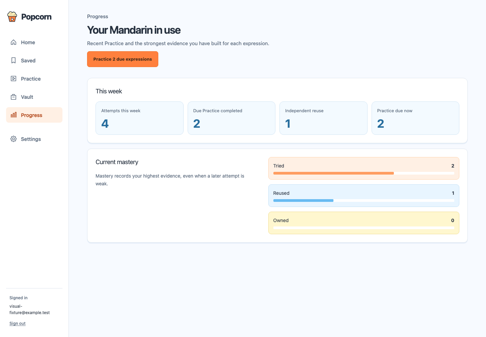](docs/assets/readme/progress-current.png) |

## 本地运行

需要 **Node.js 24.5+、pnpm 11.19.0、Docker 和 Chrome 116+**。数据库、账号、模型及扩展的一次性配置见[中文使用指南](docs/operations/user-guide.zh-CN.md)或 [English self-host guide](docs/operations/local-self-host.md)。

```bash
git clone https://github.com/LLLJJJcon/popcorn.git
cd popcorn
pnpm install --frozen-lockfile
# 完成一次性配置后：
pnpm popcorn:start
pnpm popcorn:stop
```

支持配置自己的 OpenAI-compatible 模型服务。密钥按指南保存在本地配置或已登录的设置中。**`pnpm db:reset` 会清空本地数据，不是日常启动或升级命令。**

[扩展安装](docs/operations/extension-install.md) · [保存与任务恢复](docs/operations/job-recovery.md) · [账号重置](docs/operations/account-reset.md) · [旧记录升级](https://github.com/LLLJJJcon/popcorn/blob/main/docs/superpowers/specs/2026-11-01-legacy-learning-card-upgrade-design.md)

## 开源与致谢

[MIT License](LICENSE)。扩展部分能力基于 [YouTube Digest](https://github.com/zarazhangrui/youtube-digest)，保留原作者署名与许可证；见 [Upstream record](extension/UPSTREAM.md) 与 [Third-party notices](THIRD_PARTY_NOTICES.md)。
