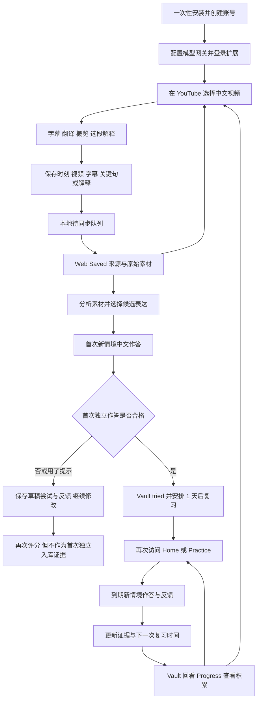

# Popcorn 产品完整说明与 Agent 交接

Popcorn 帮助以英语为辅助语言的中级中文学习者，把 YouTube 中看懂、收藏过的中文表达，转化为自己能在新情境中使用的表达。产品由 Chrome 扩展和 Web 学习工作台组成，核心流程是：观看与理解 → 保存真实语境 → 选择表达 → 原创作答与反馈 → 长期表达库 → 到期迁移练习 → 查看使用证据 → 继续观看和练习。

本文面向需要评估现有产品并提出优化建议的 agent。它同时提供产品解释、操作链路、业务规则、实现边界和代码导航。先阅读第 1 至 4 节理解产品，再结合第 5 至 11 节查看实现，最后使用第 12 至 15 节开展评估。

- 核对日期：2026 年 10 月 31 日。
- 对照版本：基于 `e277daf` 的本地工作区，包含 Saved 紧凑操作入口和单条移除功能；它不是对线上部署版本的声明。
- 运行形态：个人本地自托管的学校项目，当前包版本为 `0.1.0`。
- 证据口径：下文“已实现”表示当前代码存在相应入口和逻辑；不等于本次重新完成真实 YouTube、Supadata、模型网关的联机验收，也不代表长期学习效果已获验证。
- 路径约定：所有代码路径均相对仓库根目录；本机根目录为 `/Users/liangjing/Desktop/Courses/internal capstone/进度`。把本文和仓库一起交给 agent，路径即可直接用于检索。
- 事实优先级：当前组件、领域逻辑和数据库迁移优先于历史设计稿。尤其不能把根目录 `产品讨论记录.md` 中早期“中文用户学英语、口语陪练、场景能力图谱”的设想当成当前功能。

## 目录

1. 产品背景与定位
2. 目标用户与用户故事
3. 产品结构与核心概念
4. 完整用户链路和闭环
5. YouTube 扩展功能说明
6. Web 工作台功能说明
7. 练习与掌握度规则
8. AI 能力与边界
9. 数据链路和系统结构
10. 异常恢复与删除闭环
11. 页面和接口导航
12. 当前限制与需要重点评估的问题
13. 成功指标和验证方式
14. Agent 阅读路线与输出要求
15. 场景走查清单

## 1 产品背景与定位

### 1.1 要解决的问题

学习者可以借助字幕和翻译看懂中文视频，却未必能在另一个场景中主动用出其中的表达。传统收藏通常只保留链接或句子，后续还需要学习者自己找回语境、提取表达、设计练习，并判断自己是否真的会用。这个断点使“看懂和收藏”很难自动转化为“能够表达”。

Popcorn 把真实内容的理解工具和主动输出练习连接起来：在观看现场留下有意义的素材，再在网站中围绕同一个表达进行新情境作答和后续复用。视频语境提供记忆线索，用户的原创作答提供学习证据。

### 1.2 产品目标

| 目标 | 用户得到的价值 | 当前承接方式 |
| --- | --- | --- |
| 降低真实视频的理解门槛 | 能跟上内容，及时理解难句 | 中文字幕、英语翻译、双语模式、概览、选段解释 |
| 降低学习素材的收集成本 | 看到有用表达时立即留下 | 当前时刻、整条视频、字幕行、选段、关键句、解释的保存 |
| 把兴趣转化为主动使用 | 不止读一遍释义，而是自己组织中文 | Saved 候选表达和首次练习 |
| 支持间隔后的迁移使用 | 隔一段时间换情境再用一次 | Practice 到期队列与后续安排 |
| 让进展有证据 | 知道哪些表达练过、复用过、积累了多少证据 | Vault 历史、掌握度、Progress 汇总 |

产品追求的是从理解到使用的转化。当前软件能记录的是产品内的中文文字作答；“现实生活中自然说出来”是更远的效果目标，尚不能由现有分数和状态直接证明。

### 1.3 当前产品边界

- 输入来源是当前观看的 YouTube 视频，主场景为桌面 Chrome 的标准观看页。
- 语言组合固定为英语辅助、简体中文目标语言。字幕服务请求原生中文轨道，接受 `zh`、`zh-CN`、`zh-Hans` 等语言标识并规范为 `zh-CN`。
- 核心输出是用户键入的中文句子；没有语音录制、发音评测、ASR、实时口语对话或真人陪练。
- 当前没有课程体系、词汇背诵课程、社交、排行榜、积分、连续打卡、收费订阅、通知提醒或商业分析后台。
- 没有任意网页、粘贴文本、任意 URL、文档上传、截图识别或视频文件导入入口。
- Save Video 保存视频的来源信息和学习快照，不下载或存储视频文件。
- Web 在较窄视口有适配，但采集依赖桌面 Chrome 扩展，不能据此描述成已有移动端完整产品。

主要依据：`README.md`、`src/contracts/source.ts`、`src/contracts/practice.ts`、`extension/manifest.json`、`docs/superpowers/specs/2026-09-05-popcorn-unified-learning-workspace-design.md`。

## 2 目标用户与用户故事

### 2.1 目标用户

核心用户是能借助中文原文和英语说明消费真实视频、但主动组织中文仍不熟练的中级中文学习者。用户已有一定语言基础，有自己感兴趣的中文 YouTube 内容，愿意在观看之外进行几分钟文字练习。

当前本地运行方式还要求使用者或协助者完成 Docker、Supabase、扩展安装和模型配置。因此“理想学习用户”和“当前能自行安装的用户”并不完全重合；安装负担也是需要评估的产品门槛。

以下用户故事用于解释当前设计意图，不代表已经完成用户访谈验证。

### 2.2 用户故事与完成标准

| 用户故事 | 对应功能 | 对用户而言何时完成 |
| --- | --- | --- |
| 我想看自己喜欢的中文视频，不想频繁切换翻译软件 | 同屏字幕、英语和双语模式 | 能继续理解当前内容并定位原句 |
| 我想先知道视频在讲什么，再决定细看哪里 | Overview、Chapters | 了解脉络并跳到感兴趣片段 |
| 我大概看懂了字面意思，但不懂这句话在这里的语气 | Explain | 知道含义、语气、交际功能和语境适配 |
| 我正在看视频，想先留住这一刻，稍后再学 | Save moment、N 快捷键 | 得到已同步或本地排队的明确反馈，继续观看 |
| 我只想保存字幕中的一行或一小段 | 字幕行 Save、选段 Save | 原文、时间点和关联语境被保留 |
| 我不知道这段内容里到底该练什么 | Saved 的 Analyze 与候选表达 | 能选择一个有解释和来源的表达 |
| 我想试试自己能不能用，而不是先看答案 | Practice this expression | 在新情境中先写出自己的中文回答 |
| 我想知道哪里需要改，怎么说更自然 | 三维反馈、自然改写、首次练习再次评分 | 看懂具体问题并完成一次有针对性的修改 |
| 我想过几天再检验一次是否还会用 | 到期 Practice | 完成新情境作答，知道下次何时复习 |
| 我记得学过类似表达，想找回来 | Vault 搜索、筛选与详情 | 找到表达、原始来源及作答历史 |
| 我想知道自己的积累是不是只有收藏 | Progress | 分清保存、练习、独立复用和掌握度 |
| 我想清理视频资料，但保留自己做过的练习 | 删除来源预览与证据保留 | 明白删除影响，清理来源并保留正式学习记录 |

## 3 产品结构与核心概念

### 3.1 两端分工

**Chrome 扩展负责观看现场。** 它靠近 YouTube 播放器，承担理解辅助、定位原句、发现值得学习的片段、低打断保存，以及跳转 Web。它不是网站复习系统的完整复制。

**Web 工作台负责后续学习。** 它把按视频组织的素材变成按表达组织的练习和长期记录，提供下一步行动、到期任务、表达检索、证据回看和模型配置。

### 3.2 用户需要理解的对象

| 概念 | 产品含义 | 与相邻概念的区别 |
| --- | --- | --- |
| Video source | 一条用户拥有的 YouTube 视频来源 | 不是视频文件，也不是某一次收藏动作 |
| Snapshot | 这条来源的一次字幕与元数据快照 | 用于固定证据，避免后续内容变化使来源对不上 |
| Saved item | 一次保存动作留下的素材 | 同一视频可以有多个保存条目 |
| Candidate expression | 从素材中识别的可练习表达 | 只是候选，尚未证明用户会用 |
| Practice draft | 由某个候选表达建立的首次练习任务 | 任务已经持久化，但还不意味着表达进入 Vault |
| Attempt | 用户一次作答及其评价 | 需要区分首次原答、参考反馈后的修改、到期复用 |
| Vault expression | 已由合格首次独立作答建立的长期表达记录 | 按表达组织，Saved 则按来源视频组织 |
| Review task | 某个表达下一次应当复习的安排 | 包含到期时间，不等同于用户已完成的作答 |
| Mastery | 当前最强的已记录使用证据状态 | 不是收藏等级，也不是对真实口语能力的客观认证 |

**Saved 和 Vault 的关键区别：Saved 是“我想学的真实素材”，Vault 是“我已经留下正式使用证据的表达”。** 保存、阅读翻译、查看概览或解释，都不会单独提升掌握度。

## 4 完整用户链路和闭环

### 4.1 整体闭环图



图中首次未合格分支没有自动连到 Vault，这是当前实现的实质限制，详见 7.2 和 12.2。主成功链路已连接；不能因此宣称所有学习失败分支都已经完善闭合。

### 4.2 第一次使用 从安装到可以学习

1. 用户在本机准备 Node、pnpm、Docker 和 Chrome，启动本地 Supabase，按指南建立本地配置和数据库。
2. 启动 Web 和后台 worker；日常入口是 `pnpm popcorn:start`，macOS 也可使用 `Start Popcorn.command`。
3. Web 根地址 `/` 根据登录状态跳到 `/sign-in` 或 `/home`。用户可以创建本地账号并登录。
4. 进入 `/settings/model-gateway`，填写显示名称、准确 HTTPS API 根地址、模型 ID 和 API Key，核对发送目标并同意启用。
5. 生成扩展并在 Chrome 加载 `dist/popcorn-extension`；使用同一个账号登录扩展。
6. 打开有原生中文字幕的公开 YouTube 视频，点击扩展图标或页面上注入的入口，打开侧栏。

**会话边界：**扩展登录和 Web 登录是两个会话。相同账号保证数据归属相同，但扩展已登录不等于 Web 已登录。首次从扩展打开 Web 时仍可能需要再登录一次。

**完成条件：**用户能在侧栏查看真实中文转录，能够保存并在同账号 Web 的 Saved 找到；需要 AI 的步骤还必须具备可用网关和运行中的相关服务。

查看：`docs/operations/user-guide.zh-CN.md`、`scripts/popcorn-local.mjs`、`scripts/build-local-extension.mjs`、`src/app/page.tsx`、`src/app/sign-in/sign-in-form.tsx`、`extension/options.js`、`extension/auth.js`。

### 4.3 观看当下 从理解到保存

1. 用户自行在 YouTube 选择视频，Popcorn 识别当前视频 ID 和播放信息；它没有独立推荐内容流。
2. 侧栏默认打开 Transcript，先获取、显示中文原文。英语或双语模式按需请求翻译。
3. 字幕随着播放高亮和滚动；点击字幕或时间点可以定位视频。用户手动滚动后可用 Follow playback 重新跟随。
4. 用户可进入 Overview 生成英文概览，查看章节与带来源时间点的中文关键句；也可以选择原文，点击 Explain 查看语境解释。
5. 根据当时意图选择一种保存方式：快速记住当前时刻、保存整条视频、保存完整字幕行、保存中文选段、保存关键句，或保存解释结果。
6. 扩展先把保存事件放入本地持久队列，再向 Web 同步。同步成功和仅排队会显示不同反馈。播放不因为保存而主动暂停，用户可继续观看。

**这一段的闭环：**不理解 → 在现场获得帮助 → 留下有原始语境的学习素材 → 继续消费内容。它完成素材采集，还没有完成主动输出学习。

### 4.4 从 YouTube 到网站 从素材到候选表达

共有三个主要跳转入口：

- 顶部 **Open Popcorn** 打开 Web 根入口 `/`，登录后进入 Home，再导航到 Saved。
- 侧栏 **Saved** 页签读取已同步的视频摘要，支持 This video / All saved；某张卡片的 **Open in Popcorn** 直接打开 `/saved/[videoSourceId]`。
- **Open Saved in Popcorn** 等恢复入口打开网站的 Saved 列表。它们帮助用户从同步状态提示进入资料库。

进入网站后：

1. `/saved` 按视频聚合已保存内容，用户选择刚才的视频。
2. `/saved/[videoSourceId]` 展示视频信息、保存时间线、每条原始内容、已有译文或解释，以及处理状态。来源时间链接可回 YouTube。
3. 后台先补齐字幕快照、关联证据。原始素材已保存不等于候选表达已生成。
4. 若已有兼容分析结果，显示候选表达；若缺少分析，点击 **Analyze**。缺少网关时提供设置入口，等待时显示状态，失败时允许重试或检查状态。
5. 一次分析提供 1 至 3 个有来源的候选表达，附英语含义、解释、语气、交际功能、语域和原文证据。置信度低于 `0.7` 时提示 **Needs your confirmation**，当前没有独立的确认编辑表单。
6. 用户点击 **Practice this expression**，创建或返回该候选对应的首次练习，进入 `/practice/[taskId]`，并携带回到原 Saved 条目的锚点。

**完成条件：**用户知道要练哪一个表达、它来自哪里，并到达可作答的练习页。Analyze 的状态恢复和首次练习的创建是两个不同步骤。

### 4.5 首次练习 从候选表达到正式学习记录

1. 页面展示目标中文表达、英语含义、新中文情境、英语作答要求和目标，以及原始视频来源。
2. 用户可展开原文证据，也可点击 **Need a hint?** 查看详细解释、功能、语气、语域。使用提示会把本次辅助等级标成 `hint`；收起提示不会撤销这个标记。
3. 用户先键入自己的中文回答，再点击 **Check my response**。当前输入上限为 5,000 字符，契约要求非空且含中文。
4. 提交时显示检查状态；超过 8 秒显示模型仍在处理的提示；失败时当前页面保留输入，用户可重试。
5. AI 返回 Accuracy、Naturalness、Context fit 的评分和英语反馈，并可能给出包含目标表达的自然中文改写。
6. 服务端按规则判断是否合格及是否独立。符合首次入库条件时，原子建立表达、来源证据、正式首次作答、掌握事件和第一次复习安排。
7. 成功后表达进入 Vault，状态为 `tried`，下一次复习在首次作答后 24 小时到期。页面显示 **Open in Vault**，当前链接实际进入 `/vault` 列表。
8. 用户可点击 **Revise and check again**，修改输入，再点击 **Check revised response** 获取新的模型评分；也可 Continue / Stop for now 回到 `/practice`。

**关键分支：**首次未通过、使用了提示，或只有修改后的答案通过时，尝试可记录在草稿体系，但当前不会自动晋升为 Vault 条目。不要把“反馈后改对了”写成已完成首次独立入库。

**这一段的闭环：**看懂的表达 → 新情境主动输出 → 具体反馈 → 定向修改；首次独立合格时进一步建立可复习的长期记录。

### 4.6 日后回访 从到期提醒到新的复用证据

1. 用户再次打开网站，可从 Home 的 Next action、主导航 Practice 或 Progress 的到期入口进入 `/practice`。
2. 页面按到期时间排列待复习记录，每轮最多取 3 个，展示中文表达、英语含义与掌握状态，并估算约 2 至 6 分钟。
3. 点击 **Start practice**，系统为当前到期记录创建或取回一个持久化迁移任务，提供不同于原练习的情境。
4. 用户仍然先作答，再查看反馈。可回看来源和使用提示；提示使用影响独立复用判断。
5. 提交成功后，同一个事务记录作答、完成当前复习、写入掌握事件，并创建下一次复习记录；当前条目从本轮和积压列表移除。
6. 反馈展示分项结果、可选自然改写、掌握状态是否变化、下次到期日和本轮剩余数量。
7. 用户可 Continue 进入本轮下一项，也可 Stop for now；停止后按剩余积压重新组成最多 3 项的下一轮入口。没有到期内容时，提供回 Saved 和 Vault 的去向。
8. 到期练习后的 **Compare with suggested revision** 允许本地改写并对照已有示范；这一步不发送新评分请求，不新增正式作答，不产生第二份复用证据。

**这一段的闭环：**已有表达 → 间隔后新情境尝试 → 反馈 → 更新证据 → 安排下一次。未通过或有辅助时，同样完成本次记录并在 1 天后再排练习，掌握度不降级。

### 4.7 长期回看 从记录回到学习行动

- **Vault**：通过中文表达、英语意思等搜索和筛选，进入详情回看含义、来源原句、时间点和作答历史；来源仍在时可回 YouTube。
- **Progress**：查看本周正式作答、到期完成、独立复用和当前掌握分布；有到期内容时直接进入 Practice，没有时回 Saved。
- **Home**：结合网关、到期任务和部分保存状态提供下一步，最近视频也可带回 Saved。
- 用户继续看新的中文视频，或在下一次到期时返回已有表达，形成素材增长和长期复用两个相互连接的循环。

当前没有邮件、推送或定时提醒召回；“日后回到产品”依赖用户主动访问。软件内形成了学习循环，但现实生活复用的记录和验证尚未接入。

### 4.8 用户闭环与功能闭环如何对应

用户闭环关注“用户带着什么问题进入，完成后得到什么，为什么会再来”；功能闭环关注“各模块是否接上，结果如何保存并驱动下一步”。两者不能只用一张导航结构图代替。

| 循环 | 用户起点与动作 | 用户得到的结果和回流理由 | 系统功能闭环 |
| --- | --- | --- | --- |
| 现场理解 | 视频里有一句不懂，查字幕、翻译或解释 | 理解语境，继续看；有价值时决定保存 | 原始转录 → 按需生成 → 关联原句展示 → 时间定位或保存 |
| 素材转学习 | 想把刚收藏的表达变成自己的话，分析并选练 | 完成原创回答，知道自己哪里会、哪里需改 | 保存事件 → 同步 → 来源快照 → 候选 → 练习草稿 → 评价 → 合格晋升 |
| 长期复用 | 回访时有表达到期，进入短时练习 | 知道隔了一段时间还能否使用、下一次何时再练 | pending review → 迁移任务 → 作答与反馈 → 完成回执 → 新 review 和掌握事件 |
| 积累与找回 | 忘了某个表达或想了解进展，搜索和回看 | 找到自己的来源与历史，再进入相关学习行动 | 正式记录 → Vault 检索与详情、Progress 汇总 → Practice 或 Saved |

素材转学习的首次失败分支、删除后复习分支仍有第 12 节所列缺口；回访召回和现实交流迁移也尚未由系统完整承接。这些是评估闭环完整性时应优先追问的部分。

### 4.9 一个贯穿示例

以下只用于说明规则，不是一次真实用户记录或实时评分结果。

1. 用户看中文视频时听到“高得要命”，通过双语字幕理解为对程度的强烈强调，保存该字幕行。
2. 用户从侧栏 Saved 卡片打开网站视频详情；素材已有原文，但还需 Analyze 提取值得练的表达。
3. 用户选择候选“高得要命”，点击 Practice this expression。系统生成一个关于普通咖啡价格的新情境，用户写下“这杯咖啡的价格高得要命。”。
4. 假设三项评分都达到 3 且用户没有用提示，首次原答被记为正式证据，表达进入 Vault 的 tried，并在 24 小时后到期。
5. 用户第二天从 Home 进入 Practice，在食堂价格的新情境中再次独立合格使用，状态变为 reused，下次安排在这次完成后 7 天。
6. 用户下次回访，在另一情境继续独立合格使用，且累计满足跨情境、跨 UTC 日期和到期任务证据要求，状态推进 owned，下一次安排为 30 天。
7. 用户可以在 Vault 回看从视频原句到自己不同回答的历史，在 Progress 看正式练习与独立复用数量，再继续看新的 YouTube 内容。
8. 若其中一次到期没有通过，系统记录这次尝试、保留最强掌握状态，并改成 1 天后再练；若最初原答就没有通过，则不会自动进入第 4 步，需要面对当前首次独立重试机制的缺口。

## 5 YouTube 扩展功能说明

### 5.1 页面入口与播放协同

| 功能 | 具体行为 | 主要查看文件 |
| --- | --- | --- |
| 打开侧栏 | Chrome 扩展图标及 YouTube 页面注入的按钮唤起 Side Panel | `extension/manifest.json`、`extension/content.js` 中 `createDigestButton` / `injectDigestButton`、`extension/background.js` |
| 识别当前视频 | 从当前观看页识别视频，监听页面切换，避免旧请求结果覆盖新视频 | `extension/sidepanel.js` 中 `checkCurrentTab` / `handleFrontTabUrl` / `startDigest` |
| 保存当前时刻 | 播放器上 Save moment 按钮或 N 快捷键，仅捕获视频 ID 和当前秒数，后台补齐原句 | `extension/content.js` 中 `saveCurrentNote` / `handleNoteKeyboardShortcut` / `buildPlayerMomentSaveInput` |
| 快捷键边界 | 输入框、textarea、contenteditable 中不触发 N 保存 | `extension/content.js` 中 `handleNoteKeyboardShortcut` |
| 时间定位 | 点击字幕、章节或关键句定位 YouTube 播放位置 | `extension/sidepanel.js` 中 `seekTo`、`extension/content.js` 中 `seekToTimestamp` |
| 播放跟随 | 字幕高亮、自动滚动；用户手动滚动后暂停跟随，可恢复 Follow playback | `extension/sidepanel.js` 中 `playbackTrackingTick` / `highlightActiveEntry` / `onContentAreaScroll` |
| 已保存标记 | 当前界面可根据字幕保存和播放器时刻保存更新字幕行标记 | `extension/sidepanel.js` 中 `recordSavedTranscriptMarker` / `updateTranscriptSavedButtons` |

已保存标记主要反映当前扩展运行时的交互状态，不能当作完整历史收藏查询。完整已同步来源以 Saved 读取结果为准。

### 5.2 Transcript 理解辅助

- 默认先展示中文字幕，不自动为整条视频生成概览。
- 支持中文、English、Bilingual 三种显示模式；英语与双语共用已有翻译结果，并对缺失内容按需请求。
- 保留字幕时间关系，支持逐行 Save 和原文选择。
- 对翻译失败的行提供重试，也有 **Retry failed** 批量恢复入口；等待、失败和已翻译内容可以分别呈现。
- Copy 复制字幕文本。代码中存在的下载辅助函数不代表已有面向用户的完整导出功能。
- 中文转录不依赖语言模型，但仍依赖字幕服务、可用本地后端及当前认证链路。扩展设置页“登录可选”的说明不能理解为全部在线功能都能匿名使用。

查看：`extension/sidepanel.html`、`extension/sidepanel.js` 中 `renderTranscript`、`handleTranscriptModeChange`、`translateTranscript`、`requestTranscriptTranslationBatch`、`retryFailedTranslations`、`copyTranscript`；后端见 `src/app/api/v1/youtube/[videoId]/transcript/route.ts`、`src/app/api/v1/youtube/[videoId]/translations/route.ts`。

### 5.3 Overview 视频概览与关键句

用户切换到 Overview 时才触发模型请求，减少只看字幕时的等待和消耗。界面支持英文视频概览、带时间点的章节导航，以及带英语释义的中文 Key Quotes。关键句可定位、Copy 或 Save，保存后进入同一条来源下的 Saved 素材体系。

当前结构化输出中 overview 是必要部分，chapters 和 keyQuotes 可以为空；空章节或关键句会隐藏相应区块。因此“能生成概览”不保证每次都有完整章节和表达推荐。当前契约中 Key Quotes 最多 5 条。

概览任务可以重试，并保存与视频、快照、job 相关的恢复标识，支持关闭再打开侧栏后衔接已有任务。

查看：`extension/sidepanel.js` 中 `switchTab` / `triggerAnalysis` / `renderAnalysisResults` / `loadOverviewResumeRecord`；`src/server/ai/prompts/youtube-overview.v1.ts`；`src/server/jobs/handlers/generate-overview.ts`。

### 5.4 选段解释

在可映射到原始字幕证据的中文文本上选择后，浮层提供 Explain 和 Save。Explain 弹层展示英语 Meaning、Tone、Communicative function、Contextual fit；可保存解释及其对应中文原文。

选择记录包含关联字幕 ID、时间范围和偏移；不只是把选中的文字脱离语境发给模型。纯英语显示中的任意英语选择并不等同于已支持的中文原文选段。

查看：`extension/sidepanel.js` 中 `setupExplainFeature` / `projectTranscriptSelection` / `showExplanation`；`src/server/ai/prompts/explain-selection.v1.ts`；`src/server/jobs/handlers/explain-selection.ts`。

### 5.5 六类保存对象

| 用户入口 | kind | 保存的关键信息 | 后续用途 |
| --- | --- | --- | --- |
| Save Video | `video` | 视频 ID、标准 URL、标题、频道、缩略图、时长、简介、当前位置、请求原生字幕快照 | 留下整条视频来源，后续围绕来源学习 |
| Save moment 或 N | `player_moment` | 视频 ID、捕获时间和当前秒数 | 先标记位置，再解析该时刻的字幕语境 |
| 字幕行 Save | `subtitle_row` | 原始中文、已有英语译文、字幕 ID、起止时间、前后语境 | 保留一条完整原句 |
| 原文选择后 Save | `subtitle_selection` | 中文选段、关联字幕 ID、偏移、起止时间、已有译文和前后语境 | 保留用户关注的局部表达 |
| Key Quote 的 Save | `key_quote` | 精确中文引文、来源字幕 ID、引文秒数 | 保存概览中发现的表达线索 |
| Save Explanation | `ai_explanation` | 选中中文、英语解释、字幕 ID、时间范围、前后语境 | 保存自己不懂的用法及解释 |

这些入口共用事件身份和同步队列；不同入口不是六套独立资料库。字幕尚未完成时，播放器时刻仍可先留下捕获描述，但完成学习材料需要后续解析成功。

查看：`src/contracts/source.ts` 的 `SavedItemInputSchema`；`extension/sidepanel.js` 中 `buildVideoSaveInput`、`buildSubtitleRowSaveInput`、`buildSubtitleSelectionSaveInput`、`buildKeyQuoteSaveInput`、`buildAiExplanationSaveInput`；`extension/content.js`；`src/server/domain/capture-save.ts`。

### 5.6 扩展 Saved 与设置

扩展 Saved 读取的是服务端已同步的视频摘要，可按当前视频或全部来源筛选，显示保存数量与处理状态，并提供网站详情跳转。它不展示 Web 的完整候选练习、Vault 历史或到期任务；本地刚排队但尚未同步的记录也可能尚未出现在这里。

扩展设置提供创建账号、登录、退出、同步状态、显式丢弃待同步记录、清理有界显示缓存。存在待同步记录时，退出需要先同步或显式丢弃，防止用户无意失去记录。清显示缓存与删除待同步事件是不同操作。

查看：`extension/sidepanel.js` 中 `loadSavedLibrary` / `renderSavedLibrary`；`extension/options.html`、`extension/options.js`、`extension/auth.js`、`extension/sync-queue.js`。

## 6 Web 工作台功能说明

### 6.1 全局框架与登录

登录后的导航依次为 Home、Saved、Practice、Vault、Progress，Settings 单独放置；全局框架提供账号和退出、当前导航状态、网关缺失提示和响应式布局。学习页面及 API 均有各自认证检查，导航可见性不替代权限校验。

查看：`src/features/shell/app-shell.tsx`、`src/features/shell/app-navigation.tsx`、`src/features/shell/gateway-notice.tsx`、`src/app/(app)/layout.tsx`、`src/server/auth/web-session.ts`、`src/server/auth/web-auth-flow.ts`。

### 6.2 Home 下一步行动

Home 展示一个主行动、Tried / Reused / Owned 快照，以及最近保存的视频。主行动的当前优先级为：

1. 没有 active 网关 → Set up model gateway。
2. 存在到期复习 → 去 Practice。
3. `unsortedSaveCount` 大于零 → 去 Saved。
4. 否则 → Continue watching on YouTube。

这里的 `unsortedSaveCount` 实际只统计状态为 `saved`、`resolving_source`、`organizing` 的保存条目，并不是“所有还没练过的素材”。已经 ready 但未练过的素材可能不会使该推荐指向 Saved。最近视频卡片仍提供另一条回访路线。

查看：`src/features/home/home-dashboard.tsx`、`src/features/home/home-runtime.ts`、`src/features/home/next-action.tsx`、`src/features/saved/api.ts` 的 `home` 查询。

### 6.3 Saved 视频资料收件箱

**列表：**按最近保存时间聚合视频卡片，显示缩略图、标题、频道、保存数量、处理状态。兼有 ready 和非 ready 视频时显示 All / Ready to learn / Processing 筛选。当前 Processing 分类覆盖所有非 ready 状态，包括失败和 unsupported，不能理解成这些项目一定还在运行。

**详情：**展示视频元信息、回 YouTube 链接、处理错误、按视频时间排序的 Saved moments。每条包含原文或捕获占位信息、已有英语译文或解释、时间链接、状态和候选表达区域。若存在兼容且已持久化的 overview，则显示 Video overview 和章节。

**候选：**缺少结果时可 Analyze，处理期间轮询状态；较长等待转后台提示，超过轮询窗口后允许 Check status。终止失败后可 Retry analysis。已有不兼容分析结果时当前可能只显示 unavailable，不一定提供同样的恢复按钮。

**删除：**每条 Saved moment 右侧提供 Delete，确认后从 Saved 移除该条及其候选区域，并更新收藏数量；保留视频来源、已有练习、掌握度和复习记录。页面底部还可预览影响并删除整条视频来源。当前没有完整编辑、归档和分类管理。

查看：`src/features/saved/saved-library.tsx`、`src/features/saved/video-card.tsx`、`src/features/saved/saved-video-detail.tsx`、`src/features/saved/saved-timeline.tsx`、`src/features/saved/candidate-list.tsx`、`src/features/saved/candidate-expression.tsx`、`src/features/saved/delete-source-dialog.tsx`、`src/features/saved/api.ts`。

### 6.4 首次表达练习

首次练习由 Saved 候选触发，路由是 `/practice/[taskId]`；`/practice` 列表本身主要承接已入库表达的到期复习，不会把所有收藏自动变成今日练习。

任务保留目标表达、新情境、英语要求、来源证据和提示。首次回答、反馈、可选自然改写以及再次修改检查都在同一工作区完成。回 Saved 链接定位到原来的保存条目。

首次练习任务持久化，尚未提交的 textarea 内容主要存在组件状态。失败后不离开页面时能保留输入；刷新、关闭或跨设备恢复未提交答案并无持久草稿保障。首次任务的视图会显示 `Current mastery: tried`，但不能据此认定已正式入库，真实入库条件见第 7 节。

查看：`src/app/(app)/practice/[taskId]/page.tsx`、`src/features/practice/practice-session.tsx`、`src/features/practice/practice-material.tsx`、`src/features/practice/evaluation-panel.tsx`、`src/server/repositories/practice-material-repository.ts`。

### 6.5 Practice 到期复习

到期页展示按时间排列、最多 3 项的一轮任务及预计用时。开始后逐项作答并提交，反馈区提供下一次到期日和可能的掌握变化；可继续、停止、进行一次示范对照。没有到期任务时提示已完成，并连接 Saved / Vault。

当前没有任意挑选多条表达、自定义会话长度、完整历史日历或手动给任何 Vault 表达立即安排一次新练习的专用界面。场景构造与后续评分的职责不同，详见 7.4。

查看：`src/app/(app)/practice/page.tsx`、`src/features/practice/due-practice.tsx`、`src/server/domain/create-transfer-task.ts`、`src/server/domain/complete-due-practice.ts`、`src/server/repositories/review-task-repository.ts`。

### 6.6 Vault 长期表达库

**搜索与筛选：**可查询表达文字、英语意思等，支持精确、前缀、包含、近似文字匹配，并显示命中原因；可按 mastery、交际功能、语域、学习日期区间筛选并清空。空查询提供最近学习结果。查询 API 还支持来源 ID，但当前搜索表单没有对应的视频选择控件。

当前前端每次取最多 20 条，API 上限为 50；没有完整翻页或无限滚动界面。高级筛选的日期转换为 UTC 零点，结果不应按用户本地日期边界想当然解释。

**详情：**显示中文表达、英语含义和解释、掌握度、语气、交际功能、语域、原始视频标题、证据原句和时间段、作答历史及三个维度反馈；存在相关记录时显示 Related expressions 并连接其详情。

相关表达主要按规范化文字和 trigram 相似度排序，最多 8 项，当前不是语义向量推荐或能力图谱。来源仍有效时，历史合并草稿尝试和正式尝试并去重；来源删除后按正式尝试记录回看，不能保证所有草稿修订仍保留。

查看：`src/features/vault/vault-search.tsx`、`src/features/vault/vault-detail.tsx`、`src/features/vault/search-schema.ts`、`src/server/repositories/expression-search-repository.ts`、`src/server/repositories/review-task-repository.ts`、`supabase/migrations/202608160013_expression_search.sql`。

### 6.7 Progress 学习证据

| 页面指标 | 当前计算口径 | 解释边界 |
| --- | --- | --- |
| Attempts this week | 当周 `attempts` 表的正式作答条数 | 不是所有草稿、失败首次回答或参考示范后修订的总数 |
| Due Practice completed | 当周完成的 review 记录 | 包括已提交但未独立合格的到期尝试 |
| Independent reuse | 当周匹配正式作答的独立迁移或 owned 阈值事件数 | 不是浏览、收藏或现实生活中的复用次数 |
| Practice due now | 当前 pending 且到期时间不晚于现在的复习数 | 是当前积压，不是限定当周的新任务数 |
| Current mastery | 当前全部正式表达的 tried / reused / owned 数量 | 保留最强证据，不因后续弱回答而降级 |

“本周”按 UTC 周一零点至下一周一零点统计。页面虽把几个数字放在 This week 区域，Practice due now 实际是即时值。正式来源证据彼此关联不完整或超过当前读取边界时，汇总可能报不可用，而不是给出静默截断后的近似数字。

查看：`src/features/progress/progress-dashboard.tsx`、`src/features/progress/schema.ts`、`src/server/repositories/progress-repository.ts`。

### 6.8 Settings 模型服务配置

用户可填写显示名称、HTTPS API base URL、模型 ID、API Key，核对准确发送目标后同意启用；还可改名、更换密钥、撤销。配置状态为 `pending_consent`、`active`、`revoked`。

网关适配为 OpenAI-compatible。URL 可包含受限的简单路径，但不接受 IP、内部主机、显式端口、用户凭证、查询或片段；服务端自行拼接模型调用路径。当前不是让用户在扩展输入模型 Key，也不是把模型 Key 填进 `.env.local`。

密钥由服务端秘密存储管理，读取设置不会返回已保存明文；用户本次新输入的密钥会在当前页面会话内暂存并展示用于核对，刷新或离开后只保留已保存状态。具体行为以设置组件和 `src/server/model-gateway/vault-secret-store.ts` 为准，不能笼统说“界面从不显示 Key”。

查看：`src/app/settings/model-gateway/model-gateway-settings.tsx`、`src/contracts/model-gateway.ts`、`src/server/model-gateway/settings-service.ts`、`src/server/model-gateway/runtime-resolver.ts`、`src/server/model-gateway/vault-secret-store.ts`、`src/server/repositories/model-gateway-settings-repository.ts`。

## 7 练习与掌握度规则

### 7.1 合格和独立使用由程序决定

模型负责返回三项 `1–5` 整数评分与解释，程序计算：

```text
passed = accuracy >= 3 AND naturalness >= 3 AND contextualFit >= 3
independentUse = passed AND assistanceLevel == none
```

三项必须分别达标，不使用总分或平均分抵消某一项不足。Accuracy 关注目标表达意义与语义关系，Naturalness 关注中文构造和用词，Context fit 关注是否完成给定场景的交际行为。反馈可以引用中文，主体使用英语。

当前模型不应输出最终 passed、独立性、掌握度、复习时间或业务 ID。程序会规范化、校验模型响应，再依据记录的辅助等级推导结果。

“独立”在系统中是依据已记录辅助等级推导的标签，不能证明用户没有在外部翻译工具或其他窗口找答案。

查看：`src/server/ai/prompts/evaluate.v1.ts` 中 `derivePracticeDecision`、`src/contracts/practice.ts`。

### 7.2 首次入库条件与修订边界

候选表达进入正式 Vault 的条件同时包括：

1. 作答属于正确用户、正确练习草稿及对应未来表达。
2. 是该草稿 `revision === 1` 的首次原答。
3. 三个维度均合格，即 `passed === true`。
4. `independentUse === true`，且 `assistanceLevel === none`。

符合时通过事务创建或返回入库回执，避免重复建立正式记录。首次保存成功但后续入库请求中断时，重复提交相同原答可重放记录并恢复晋升；这与“给相同任务换一句新原答”不同，后者可能触发修订冲突。

之后的 revision 可再次评分，但不重新执行首次晋升。当前首次失败后仅修改通过，并没有自动建立新的独立尝试轮次和入库路径；重新从同一个候选点 Practice 还会复用原有草稿。这个分支需要产品与工程共同完善，不能用“用户再试一次就会入库”略过。

查看：`src/server/repositories/attempt-repository.ts` 中 `submitOriginal` / `submitRevision` / `promoteIfEligible`；`src/server/domain/record-valid-attempt.ts`；`src/server/domain/create-practice-task.ts` 中 `activate`；`supabase/migrations/202608160012_promote_practice_attempt.sql`。

### 7.3 掌握度状态机

| 当前状态 | 发生的证据 | 下一状态 |
| --- | --- | --- |
| 尚未正式入库 | 首次原创独立合格回答并成功晋升 | `tried` |
| `tried` | 到期任务中一次成功独立迁移 | `reused` |
| `reused` | 再次独立合格，且正式独立合格证据覆盖至少 2 个情境指纹、至少 2 个 UTC 日期，并包含到期练习 | `owned` |
| `reused` | 独立合格但尚不满足 owned 阈值 | 保持 `reused` |
| 任一正式状态 | 到期失败或有辅助 | 保持当前状态 |
| `owned` | 后续任何记录 | 保持 `owned`，按本次表现调整复习时间 |

一次 `tried` 的成功到期回答先变为 `reused`，不会在同一步直接跳到 `owned`。`owned` 表示达到当前软件定义的证据阈值，不等同于永不遗忘或真实口语已掌握。

情境指纹来自题目和任务字段的规范化哈希；它能区分任务文本，尚不能保证两个情境在语义上充分不同。

查看：`src/server/domain/mastery.ts`、`supabase/migrations/202608160014_due_practice_completion.sql`。

### 7.4 复习排程与题目构造

| 情况 | 下次间隔 |
| --- | --- |
| 首次进入 tried | 从首次作答时间起 1 天 |
| 到期失败或使用辅助 | 从本次完成时间起 1 天 |
| 成功独立复用，结果尚非 owned | 从本次完成时间起 7 天 |
| 成功独立复用，结果为 owned | 从本次完成时间起 30 天 |

这里的一天是 24 小时，并非次日当地零点。排程是固定规则，不是 FSRS、SM-2 或根据遗忘曲线拟合的个体化算法。

**首次题目**由模型基于候选意义与原文证据生成，要求是新的简短中文情境、不含目标表达且不提前给答案。页面另外显示目标表达本身，因此这是“指定表达在新场景中的使用练习”，不是完全无提示的自由回忆。

**到期题目**当前由 `buildDueTransferTask` 固定构造，在食堂午餐、网购充电线、打车、租雨伞四种高价反应场景间选择，使用序号调整金额并尽量避开先前场景。它不调用模型生成情境，只在提交后调用模型评分。四种模板不一定适合任意交际功能，是影响真实迁移质量的重要限制。

查看：`src/server/domain/schedule-review.ts`、`src/server/ai/prompts/activate.v1.ts`、`src/server/domain/create-transfer-task.ts`。

### 7.5 两类修改操作不能混淆

| 场景 | 修改后发生什么 | 是否产生新的模型反馈 | 是否额外推进正式学习证据 |
| --- | --- | --- | --- |
| 首次练习的 Check revised response | 持久化下一版草稿尝试并重新评价 | 是 | 不执行首次晋升，也不算独立迁移 |
| 到期练习的 Show comparison | 当前页面显示本地改写与已有自然改写对照 | 否 | 否 |

自然改写是可选项；没有合格改写时，到期页面不提供相应对照动作。

## 8 AI 能力与边界

### 8.1 AI 任务清单

| 任务 | 输入与输出 | 触发点 | 主要实现 |
| --- | --- | --- | --- |
| 字幕翻译 | 原始中文字幕 → 英语译文 | 切英语或双语、翻译重试 | `src/server/ai/prompts/translate-segments.v1.ts`、`src/server/jobs/handlers/translate-segments.ts` |
| 视频概览 | 有索引的中文字幕 → 英语概要、可选章节与精确中文引文 | Overview | `src/server/ai/prompts/youtube-overview.v1.ts`、`src/server/jobs/handlers/generate-overview.ts` |
| 选段解释 | 中文选择与原始语境 → 英语含义、语气、交际功能、适配解释 | Explain | `src/server/ai/prompts/explain-selection.v1.ts`、`src/server/jobs/handlers/explain-selection.ts` |
| 保存素材分析 | 素材和来源行 → 1 至 3 个可复用表达 | Saved Analyze 或已有结果恢复 | `src/server/ai/prompts/analyze-saved-item.v1.ts`、`src/server/jobs/handlers/analyze-saved-item.ts` |
| 首次练习情境 | 表达、意义、功能、证据 → 新中文情境 | Practice this expression | `src/server/ai/prompts/activate.v1.ts`、`src/server/domain/create-practice-task.ts` |
| 作答评价 | 目标表达、情境、用户回答 → 三维评价和可选自然改写 | 首次提交、首次修订、到期提交 | `src/server/ai/prompts/evaluate.v1.ts`、`src/server/repositories/attempt-repository.ts`、`src/server/domain/complete-due-practice.ts` |

原生字幕获取由 Supadata 完成，不应列成“模型听视频生成字幕”；到期场景当前也不属于 AI 生成能力。

### 8.2 可信边界

- 模型提供语言内容和判断依据，服务端负责来源 ID、时间戳、用户归属、哈希、最终状态和排程。
- 模型返回的来源行索引必须映射到服务器已有字幕；不能凭模型自己填写的时间点建立来源证据。
- 请求和生成结果经过结构化规范化与 Zod 校验。部分可选内容可以被丢弃或为空，不一定导致整项可用结果失败。
- 用户字幕、选择和回答作为学习数据处理，不能成为修改系统指令的权威来源。
- 生成材料、任务和评价记录包含 prompt、模型与网关版本信息，支持追踪；不是所有用户可见输出都使用同一个生成版本。
- 模型可用性、输出稳定性和评分质量影响学习体验；校验通过只能证明满足格式和部分来源约束，不能证明语用评价正确。

查看：`src/server/ai/model-output.ts`、`src/server/ai/structured-json-gateway.ts`、`src/server/ai/model-gateway.ts`、`src/server/ai/openai-compatible-provider.ts`、`src/server/model-gateway/runtime-resolver.ts`、`src/server/jobs/process-jobs.ts`。

## 9 数据链路和系统结构

### 9.1 从一次保存到长期复习的数据流

```text
YouTube 页面或侧栏
  → 带 clientEventId 的保存事件
  → Chrome 本地 ownerUserId 绑定队列
  → extension/sync 批量同步
  → video_sources + saved_items
  → resolve_snapshot 持久任务
  → video_snapshots + transcript_segments
  → analyze_saved_item → generated_artifacts 内的候选表达
  → practice_drafts + practice_draft_attempts
  → 首次合格晋升事务
  → expression_senses + expression_occurrences + user_expressions
  → practice_tasks + attempts + mastery_events + review_tasks
  → 到期练习完成事务
  → 新 attempt + 完成当前 review + 新 review + 更新 mastery
  → Vault / Home / Progress 的读取投影
```

字幕与理解功能也可以先于保存请求运行；读取某条视频的 transcript 不代表它已经成为用户 Saved 列表中的收藏。Saved 列表以实际保存条目聚合来源。

### 9.2 技术模块

| 模块 | 职责 | 路径 |
| --- | --- | --- |
| Next.js 16 与 React 19 | 页面、工作台、服务端 API | `src/app/`、`src/features/`、`package.json` |
| Chrome Manifest V3 扩展 | 页面交互、Side Panel、Service Worker、同步 | `extension/` |
| 契约 | 语言、保存对象、任务、反馈、掌握度、网关 schema | `src/contracts/`、`src/features/practice/material-schema.ts` |
| 领域服务 | 保存、练习创建、首次晋升、复习、删除 | `src/server/domain/` |
| 数据访问 | 按用户读取、来源组装、搜索、学习历史与统计 | `src/server/repositories/` |
| 字幕供应商 | 请求原生中文、轮询、转录规范化 | `src/server/transcript/` |
| AI 与网关 | 模型适配、提示词、结果校验、凭据解析 | `src/server/ai/`、`src/server/model-gateway/` |
| 后台任务 | 持久任务领取、lease、重试、产物落库 | `src/server/jobs/`、`scripts/process-local-jobs.mjs` |
| Supabase | PostgreSQL、认证、RLS、事务函数、秘密存储 | `supabase/migrations/`、`supabase/config.toml` |
| 本地运维 | 日常启停、扩展构建、演示数据 | `scripts/popcorn-local.mjs`、`scripts/build-local-extension.mjs`、`scripts/seed-demo.ts` |

后续修改 Next.js 代码前，应按仓库 `AGENTS.md` 先阅读 `node_modules/next/dist/docs/` 的相关指南，不能直接套用旧版本习惯。

### 9.3 需要理解的持久对象

来源层为 `video_sources`、`video_snapshots`、`transcript_segments`、`saved_items`；生成层为 `generated_artifacts` 和 `knowledge_jobs`；首次尝试层为 `practice_drafts`、`practice_draft_attempts`；正式学习层为 `expression_senses`、`expression_occurrences`、`user_expressions`、`practice_tasks`、`attempts`、`mastery_events`、`review_tasks`。晋升与到期完成另有回执，用来保证重复请求不会重复计数。

完整表定义和外键以迁移为准，尤其要连读：

- `supabase/migrations/202608160001_schema.sql`
- `supabase/migrations/202608160002_rls.sql`
- `supabase/migrations/202608160011_practice_drafts.sql`
- `supabase/migrations/202608160012_promote_practice_attempt.sql`
- `supabase/migrations/202608160014_due_practice_completion.sql`
- `supabase/migrations/202608220016_source_deletion.sql`
- `supabase/migrations/202609060017_practice_feedback_text.sql`

`src/types/database.generated.ts` 便于查看类型，但业务事务的最终含义应结合最新 SQL 读取，不能只看初始建表迁移。

## 10 异常恢复与删除闭环

### 10.1 保存恢复

本地队列绑定用户，保存时先写队列，再尝试网络。服务端按事件身份保证幂等；重复传输同一个事件不重复生成一次收藏，但用户再次主动点击产生的新事件不等同于自动内容去重。

网络或本地 Web 不可用时，事件保持 pending，使用 Chrome alarms 指数退避重试；恢复登录、打开侧栏或 worker 启动时会继续尝试。当前单事件容量约 64 KB、队列预算 5 MB、每批最多 50 项；容量不足会显示失败，不能宣称无限离线保存。

未登录扩展时新保存不会直接进入某个匿名账号队列，而是返回需要认证。更换账号不能把另一账号的待同步事件发送到新账号。

查看：`extension/sync-queue.js`、`extension/background.js`、`extension/auth.js`、`src/server/domain/capture-save.ts`。

### 10.2 处理状态与恢复入口

| 所处阶段 | 状态或表现 | 用户或系统下一步 |
| --- | --- | --- |
| 保存尚未同步 | Queued / retrying automatically | 保留扩展存储，恢复本地服务后自动同步 |
| 原始保存已落库 | `saved` / `resolving_source` / `organizing` | 补齐来源快照，显示已有原文，允许继续观看 |
| 原始材料就绪 | `ready` | 可浏览；若尚无候选分析，再 Analyze |
| 字幕不支持 | `unsupported` | 提示需要原生中文字幕，不能用生成翻译冒充原生来源 |
| 来源处理失败 | `failed` | 原始捕获仍可留存，按故障类别恢复服务；并非所有失败都有统一的一键重跑页面 |
| 候选分析处理中 | pending / leased 与界面等待状态 | 轮询；长等时转后台，之后 Check status |
| 候选分析终止失败 | 模型不可用、输出异常或内部错误 | Retry analysis；必要时检查网关 |
| Practice 提交失败 | 页面提示失败，文字仍在 | 保持页面并重试；不要把组件状态当成跨刷新持久草稿 |

`ready` 表示素材组织状态，不等于已经练过、已经入 Vault 或模型所有学习产物齐全。Saved、knowledge job 和 mastery 是三个不同维度，不能混成一个进度条。

后台任务状态包括 `pending`、`leased`、`succeeded`、`retryable_failed`、`terminal_failed`。后台进程重启可恢复到期工作；当前没有面向学习者的完整任务控制台。

查看：`src/contracts/source.ts`、`src/contracts/knowledge.ts`、`src/server/domain/lease-job.ts`、`src/server/jobs/process-jobs.ts`、`docs/operations/job-recovery.md`。

### 10.3 删除来源的闭环

**单条移除：**通过 `removed_from_saved_at` 持久标记从 Saved 移除，不删除支撑练习的原始来源与关联数据。列表、详情、收藏数量和待整理数量均排除已移除条目；移除最后一条时返回 Saved 列表。失败时保留确认区域供重试。

**整段视频删除：**

删除前展示视频标题、将删除的保存数、受影响的已练表达数，并要求勾选理解影响。

- 没有正式练过的表达：删除该来源与衍生素材。
- 已存在正式学习记录：删除来源内容、字幕、引文关联、相关草稿等，保留正式表达、正式作答、掌握记录和复习安排；Vault 显示 Source deleted，不再展示视频链接、时间戳和原始证据。
- 删除后的失败提示留在当前页，成功返回 Saved；不是只把卡片从前端隐藏。

**尚需验证的后续链路：**当前到期材料加载仍依赖原始 occurrence、snapshot 和 source。删除来源虽然保留 review 数据，但能否继续打开并完成其到期练习，存在实现断点风险；不能把“保留复习记录”表述为“删除后复习体验已完整可用”。

查看：`src/features/saved/delete-source-dialog.tsx`、`src/server/domain/plan-source-deletion.ts`、`src/server/domain/delete-source.ts`、`supabase/migrations/202608220016_source_deletion.sql`、`src/server/repositories/practice-material-repository.ts` 的 `findDueMaterial`。

## 11 页面和接口导航

### 11.1 网站页面

| 路由 | 页面文件 | 首要功能实现 |
| --- | --- | --- |
| `/` | `src/app/page.tsx` | 登录状态分流 |
| `/sign-in` | `src/app/sign-in/page.tsx` | `src/app/sign-in/sign-in-form.tsx` |
| `/home` | `src/app/(app)/home/page.tsx` | `src/features/home/home-dashboard.tsx` |
| `/saved` | `src/app/(app)/saved/page.tsx` | `src/features/saved/saved-library.tsx` |
| `/saved/[videoSourceId]` | `src/app/(app)/saved/[videoSourceId]/page.tsx` | `src/features/saved/saved-video-detail.tsx` |
| `/practice` | `src/app/(app)/practice/page.tsx` | `src/features/practice/due-practice.tsx` |
| `/practice/[taskId]` | `src/app/(app)/practice/[taskId]/page.tsx` | `src/features/practice/practice-session.tsx` |
| `/vault` | `src/app/(app)/vault/page.tsx` | `src/features/vault/vault-search.tsx`、`src/features/vault/vault-list.tsx` |
| `/vault/[userExpressionId]` | `src/app/(app)/vault/[userExpressionId]/page.tsx` | `src/features/vault/vault-detail.tsx` |
| `/progress` | `src/app/(app)/progress/page.tsx` | `src/features/progress/progress-dashboard.tsx` |
| `/settings/model-gateway` | `src/app/(app)/settings/model-gateway/page.tsx` | `src/app/settings/model-gateway/model-gateway-settings.tsx` |

表格中的路径均从仓库根目录起算，页面文件负责路由入口，功能组件负责主要交互。

### 11.2 主要接口

| 接口 | 用途 | 路由文件 |
| --- | --- | --- |
| `POST /api/v1/saved-items` | 单个保存事件 | `src/app/api/v1/saved-items/route.ts` |
| `POST /api/v1/extension/sync` | 扩展批量同步及逐事件回执 | `src/app/api/v1/extension/sync/route.ts` |
| `GET /api/v1/extension/saved` | 扩展读取已同步来源摘要 | `src/app/api/v1/extension/saved/route.ts` |
| `GET /api/v1/youtube/[videoId]/transcript` | 获取或恢复原生字幕 | `src/app/api/v1/youtube/[videoId]/transcript/route.ts` |
| `POST /api/v1/youtube/[videoId]/overview` | 创建或恢复概览 | `src/app/api/v1/youtube/[videoId]/overview/route.ts` |
| `POST /api/v1/youtube/[videoId]/translations` | 请求指定字幕翻译 | `src/app/api/v1/youtube/[videoId]/translations/route.ts` |
| `POST /api/v1/explanations` | 请求选段解释 | `src/app/api/v1/explanations/route.ts` |
| `GET /api/v1/jobs/[jobId]` | 获取归属当前用户的任务状态 | `src/app/api/v1/jobs/[jobId]/route.ts` |
| `GET /api/v1/saved` | 网站视频资料列表 | `src/app/api/v1/saved/route.ts` |
| `GET /api/v1/saved/[videoSourceId]` | 来源详情 | `src/app/api/v1/saved/[videoSourceId]/route.ts` |
| `GET /api/v1/saved/[videoSourceId]/delete-preview` | 删除影响 | `src/app/api/v1/saved/[videoSourceId]/delete-preview/route.ts` |
| `DELETE /api/v1/saved/[videoSourceId]` | 删除来源 | `src/app/api/v1/saved/[videoSourceId]/route.ts` |
| `DELETE /api/v1/saved/[videoSourceId]/moments/[savedItemId]` | 从 Saved 移除单条素材，保留学习记录 | `src/app/api/v1/saved/[videoSourceId]/moments/[savedItemId]/route.ts` |
| `GET /api/v1/saved-items/[savedItemId]/candidates` | 读取候选或查询指定 job | `src/app/api/v1/saved-items/[savedItemId]/candidates/route.ts` |
| `POST /api/v1/saved-items/[savedItemId]/candidates` | 分析或重试分析 | `src/app/api/v1/saved-items/[savedItemId]/candidates/route.ts` |
| `POST /api/v1/practice/tasks` | 从候选激活首次练习 | `src/app/api/v1/practice/tasks/route.ts` |
| `POST /api/v1/practice/attempts` | 首次原答与可能的入库 | `src/app/api/v1/practice/attempts/route.ts` |
| `POST /api/v1/practice/attempts/[attemptId]/revisions` | 首次练习修订并再次评价 | `src/app/api/v1/practice/attempts/[attemptId]/revisions/route.ts` |
| `GET /api/v1/practice/due` | 到期队列 | `src/app/api/v1/practice/due/route.ts` |
| `GET /api/v1/practice/due/[reviewTaskId]` | 构造或取回到期迁移任务 | `src/app/api/v1/practice/due/[reviewTaskId]/route.ts` |
| `POST /api/v1/practice/due/[reviewTaskId]` | 评价并原子完成到期练习 | `src/app/api/v1/practice/due/[reviewTaskId]/route.ts` |
| `GET /api/v1/vault` | 表达列表或搜索 | `src/app/api/v1/vault/route.ts` |
| `GET /api/v1/vault/[userExpressionId]` | 表达详情与相关表达 | `src/app/api/v1/vault/[userExpressionId]/route.ts` |
| `GET /api/v1/progress` | 学习证据汇总 | `src/app/api/v1/progress/route.ts` |
| `/api/v1/settings/model-gateway` | GET 读取，PUT 根据请求体创建、改名或换 Key，DELETE 撤销 | `src/app/api/v1/settings/model-gateway/route.ts` |
| `POST /api/v1/settings/model-gateway/consent` | 同意准确目标并启用 | `src/app/api/v1/settings/model-gateway/consent/route.ts` |
| `POST /api/internal/jobs/process` | 内部 worker 处理任务 | `src/app/api/internal/jobs/process/route.ts` |

接口不是天然可匿名调用的公共服务。Web 使用 cookie 会话，扩展通过自己的认证请求后端；内部任务接口另有内部认证。修改权限或恢复行为时必须连同对应服务及数据库约束阅读。

## 12 当前限制与需要重点评估的问题

### 12.1 评估时必须保留的事实边界

- 已有主成功链路，但学习失败后的重新开始、删除来源后的继续复习等分支不能按理想设计补全。
- 目前没有个性化长期教学规划，也没有将不同表达组织成能力成长图谱。
- Practice 是指定表达的文字使用练习，没有测量即时口语反应速度、听力提升或真实对话迁移。
- 语言契约写死英语和简体中文，多语言需要改契约、提示词、校验、UI 和数据假设，不能只加语言下拉框。
- 没有已实施的用户研究结果、学习效果因果证明或商业指标基线；不要把演示截图和固定测试数据当成真实学习成效。

### 12.2 从当前实现识别的评估重点

以下是根据代码识别的待评估问题。它们提供调查入口，不代表已经决定按某个方案改造。

| 问题 | 对用户闭环的影响 | 证据入口 | 应进一步验证什么 |
| --- | --- | --- | --- |
| 首次失败或用提示后缺少新的独立入库轮次 | 最需要帮助的用户可能始终停留在草稿，无法进入长期复习 | `src/server/repositories/attempt-repository.ts`、`src/server/domain/create-practice-task.ts` | 能否保留辅助学习，再在新情境开启可独立完成的一轮 |
| 到期场景都是高价反应模板 | 任意表达可能被放入不适合的交际场景，损害反馈可信度 | `src/server/domain/create-transfer-task.ts` | 不同交际功能下题目适配性、变化程度和生成成本 |
| Home 把部分处理状态当作待整理数 | ready 但未练的素材可能被忽略，下一步过早指向 YouTube | `src/features/home/next-action.tsx`、`src/features/saved/api.ts` | 应按“下一项学习动作”还是“后台处理状态”决定推荐 |
| 首次练习尚未入库就显示 tried | 用户可能误以为打开题目已经获得掌握记录 | `src/server/repositories/practice-material-repository.ts`、`src/features/practice/practice-material.tsx` | 是否需要未练或待验证视图状态 |
| 再打开同一首次任务时视图没有恢复上一轮结果 | 持久草稿存在，但刷新后的表单可能重新提交原答并遇到冲突 | `src/features/practice/practice-session.tsx`、`src/server/repositories/attempt-repository.ts` | 跨刷新恢复、失败重试和修订入口是否一致 |
| 删除来源保留 reviews，但到期材料仍依赖来源 | 用户看到保留记录，却可能无法继续练习 | `src/server/repositories/practice-material-repository.ts`、`supabase/migrations/202608220016_source_deletion.sql` | 删除后的到期打开、评分和后续排程端到端行为 |
| 历史与 Progress 统计口径不同 | 用户反复修改但统计不增加，可能不理解自己的努力如何记录 | `src/server/repositories/review-task-repository.ts`、`src/server/repositories/progress-repository.ts` | 是否分别呈现学习尝试与正式独立证据 |
| 两端都称 Saved，但展示层级不同 | 扩展视频摘要、Web 时间线和 Vault 表达容易混淆 | `extension/sidepanel.js`、`src/features/saved/`、`src/features/vault/` | 用户是否理解素材、表达、练习之间的区别 |
| 独立性依赖界面辅助标记 | 显示原文、英语含义和外部工具的影响未充分表达 | `src/features/practice/practice-material.tsx`、`src/server/ai/prompts/evaluate.v1.ts` | “独立”的产品含义和反馈措辞是否过强 |
| owned 保持不降级，题目差异由文本哈希衡量 | 强证据状态不直接反映最近遗忘，文本变化可能被高估为迁移 | `src/server/domain/mastery.ts`、`supabase/migrations/202608160014_due_practice_completion.sql` | 是否应区分历史最佳证据和当前可用性 |
| 分析、激活和评分失败反馈不完全一致 | 用户可能不知道等待、检查设置还是重新开始；激活失败当前主要解除按钮 pending | `src/features/saved/candidate-list.tsx`、`src/features/practice/practice-session.tsx` | 每一阶段的恢复文案、保留内容和明确下一步 |
| 数据读取存在固定上限 | 学习量增长后搜索、历史、到期列表与汇总的完整性可能受影响 | `src/server/repositories/review-task-repository.ts`、`src/server/repositories/progress-repository.ts`、`src/features/vault/vault-search.tsx` | 分页、超限展示和长期使用规模 |
| 安装与两端登录负担 | 目标学习者到首次成功保存前步骤较多 | `docs/operations/user-guide.zh-CN.md`、`extension/options.html` | 首次安装完成率、首次价值时间、账号衔接 |
| 到期会话最多 3 项但积压可能更多 | 单轮完成感和真实剩余负担可能不一致 | `src/features/practice/due-practice.tsx` | 是否需要显示总积压、继续下一轮或优先级 |
| 用户必须主动回来 | 有排程但缺少召回渠道，复习可能长期无人完成 | `src/features/home/next-action.tsx`、`src/features/progress/progress-dashboard.tsx` | 是先改善回访入口，还是有证据后再增加提醒 |

### 12.3 不应被误认为当前功能的历史设想

根目录早期讨论中的通用外语定位、中文用户学英语、朋友式 AI 人格、处理速度训练、口语场景能力图、跨素材综合对话、游戏化成就和多语言方向，都应作为历史想法或未来假设评估。当前产品不能自动继承这些承诺。

历史设计可解释取舍，但应先看较新的覆盖关系：`docs/superpowers/specs/2026-08-22-popcorn-local-first-school-demo-design.md`、`docs/superpowers/specs/2026-09-05-popcorn-unified-learning-workspace-design.md`、`docs/superpowers/specs/2026-09-06-popcorn-structured-output-reliability-design.md`。不要把设计文档中尚未落地的细节写回事实清单。

## 13 成功指标和验证方式

### 13.1 产品目标对应的候选指标

下表是用于后续评估的指标建议。现有 Progress 只实现其中一部分，完整埋点、漏斗、留存分析后台尚不存在。

| 需要回答的问题 | 候选指标 | 当前数据基础或缺口 |
| --- | --- | --- |
| 用户能否顺利开始 | 从启动到首次真实保存和首次练习的耗时、完成率 | 需要流程事件和研究记录，不能仅从成功记录反推 |
| 收藏是否进入学习 | 保存到查看、Analyze、激活、首次提交、首次入库的转化 | 已有部分持久实体，缺少完整曝光与退出事件 |
| 学习是否可持续 | 到期完成率、逾期天数、回访后的练习启动率 | `review_tasks` 有安排与完成证据，访问和曝光需补充 |
| 是否发生独立复用 | 新情境独立合格比例、跨日期跨情境使用 | 正式 attempts、mastery events 已有基础，需检查题目适配 |
| 反馈是否有帮助 | 用户理解率、修改改善、人工评审一致性 | 有反馈与部分修订历史，需要人工标注和用户研究 |
| 采集是否可靠 | 排队到同步时间、错误比例、重复率、来源追溯成功率 | 队列、job 与来源记录可支持诊断，尚无统一可视化 |
| 是否迁移到现实交流 | 现实场景复用报告或前后测 | 当前没有直接采集机制，不能用 owned 代替 |

### 13.2 工程验证入口

| 范围 | 查看位置 | 能支持的判断 |
| --- | --- | --- |
| 掌握和排程规则 | `src/server/domain/mastery.test.ts`、`src/server/domain/schedule-review.test.ts`、`src/server/domain/complete-due-practice.test.ts` | 状态与排程是否符合既定规则 |
| 首次提交与晋升 | `tests/integration/practice/attempts.test.ts`、`supabase/tests/promote_practice_attempt.sql` | 原答、修订和正式入库边界 |
| 到期原子完成 | `supabase/tests/due_practice_completion.sql`、`src/features/practice/due-practice.test.tsx` | 完成、重复请求、反馈与队列行为 |
| Saved 与候选恢复 | `src/features/saved/candidate-list.test.tsx`、`src/features/saved/saved-video-detail.test.tsx` | 分析状态、候选入口与来源回看 |
| Vault 与统计 | `src/features/vault/vault-search.test.tsx`、`src/features/vault/vault-detail.test.tsx`、`src/features/progress/progress-dashboard.test.tsx` | 筛选、历史和统计呈现 |
| 扩展采集 | `extension/tests/save-payloads.test.js`、`extension/tests/transcript-selection.test.js`、`extension/tests/sync-queue.test.js`、`extension/tests/worker-restart.test.js` | 六类载荷、原文选择、队列恢复 |
| 端到端主链 | `tests/e2e/saved-learning-loop.spec.ts`、`tests/e2e/returning-learner.spec.ts`、`tests/e2e/extension/acquisition-save.spec.ts` | 自动化环境中的跨页与回访行为 |
| 权限和删除 | `supabase/tests/rls.sql`、`supabase/tests/source_deletion.sql` | 用户隔离、来源清理及正式证据保留 |
| 已有验收过程 | `docs/engineering/execution-ledger.md`、`docs/engineering/checkpoints/` | 历史验证范围和当时结果 |

测试文件存在不代表本次重新跑过，也不自动证明所有真实供应商链路可用。`package.json` 的 `test:extension` 当前只运行一个指定的小范围过滤集合，不能把它的成功解释为扩展全部测试通过。需要评估全量行为时，应先检查实际脚本和测试前置条件。

演示数据脚本为 `scripts/seed-demo.ts`。固定 fixture 与截图演示可说明交互，不能验证实时模型的教学质量或 Supadata 可用性。

## 14 Agent 阅读路线与输出要求

### 14.1 建议的阅读顺序

1. 阅读本文第 1 至 4 节，确认目标用户、两端分工和完整学习链路。
2. 阅读 `README.md` 和 `docs/operations/user-guide.zh-CN.md`，了解实际入口、安装及操作前提。
3. 依次阅读 `extension/sidepanel.html`、`extension/content.js`、`extension/sidepanel.js`、`extension/background.js`、`extension/sync-queue.js`，理解观看与采集。
4. 按 `src/features/home/` → `saved/` → `practice/` → `vault/` → `progress/` 阅读网站功能和跳转。
5. 阅读 `src/server/domain/create-practice-task.ts`、`src/server/domain/record-valid-attempt.ts`、`src/server/domain/mastery.ts`、`src/server/domain/schedule-review.ts`、`src/server/domain/create-transfer-task.ts`、`src/server/domain/complete-due-practice.ts`，理解学习证据规则。
6. 阅读 `src/server/ai/prompts/` 和 `src/server/model-gateway/`，理解生成质量、延迟和配置边界。
7. 阅读相关 repository、最新 SQL 及对应测试，核对 UI、服务与持久层是否一致。
8. 结合第 12 节做走查，再提出建议；不要先按历史愿景重设计一个不同产品。

### 14.2 交给评估 agent 的任务说明

可将以下文字与本文、代码仓库一起提供：

> 请先依据这份说明和当前代码理解 Popcorn，再评估产品。目标用户是以英语为辅助语言的中级中文学习者，当前产品形态是 YouTube Chrome 扩展加本地 Web 工作台。请逐段检查从观看、理解、采集、同步、选择表达、首次作答、反馈修订、正式入库、到期复用到长期回看的闭环，尤其检查失败和退出后的去向。
>
> 请分别给出体验问题、学习机制问题、现有功能修复和新增功能建议。每项说明具体用户场景、当前行为、问题原因、建议行为、预期价值、涉及文件、依赖与大致工作量、风险、验证方式和优先级。区分已确认事实、代码推断与仍需用户研究验证的假设。优先处理阻碍现有闭环的问题，再考虑扩展功能。
>
> 不要将历史讨论、测试 fixture、演示截图或功能名称当成已经完整实现的能力。不要默认改造成课程平台、语音聊天产品或多语言 SaaS。若建议扩大边界，说明它服务哪个现有痛点、为什么值得增加复杂度，并给出更小范围的替代方案。当前任务是提出建议；没有另外授权时，不直接修改产品代码。

### 14.3 建议输出格式

每项建议至少包含：

```text
问题或机会：
对应用户与具体场景：
当前行为及证据文件：
对哪一段闭环造成影响：
建议改成什么行为：
属于修复现有功能还是新增能力：
预期价值与验证指标：
涉及模块与依赖：
实施范围与风险：
优先级与排序理由：
哪些判断仍需联机走查或用户研究：
```

建议结果先给出产品复述和最关键的闭环问题，再列优先级。不要只有抽象原则，也不要只给一串没有用户场景的技术重构任务。

## 15 场景走查清单

这份清单用于检查接手 agent 是否真正理解流程，也可以用于后续人工验收；它不是本次已经执行通过的测试报告。

| 场景 | 应观察的关键结果 |
| --- | --- |
| 新用户打开根地址 | 能注册或登录，知道需要完成哪些配置 |
| Web 已登录，从扩展点 Open Popcorn | 到 Home；Web 未登录时先登录 |
| 在标准中文视频页打开侧栏 | 中文转录先可读，Overview 不强制自动生成 |
| 切换英语和双语 | 译文关联正确原文；部分失败可定位和重试 |
| 点击字幕与手动滚动 | 可定位视频，跟随暂停后可恢复 |
| 使用 N 保存当前时刻 | 不在输入框误触；有保存或排队反馈 |
| 分别使用六种保存入口 | 都落到同账号、同来源体系，携带各自原始证据 |
| Web 暂停时保存后再恢复 | 本地事件继续同步，不重复计算同一事件 |
| 扩展 Saved 尚看不到刚排队的内容 | 文案能解释“排队”和“已同步”的区别 |
| 从扩展卡片进网站详情 | 用户不必重新搜索来源，可回到原视频 |
| Saved 无候选或缺网关 | Analyze、状态、设置和重试入口可理解 |
| 首次独立原答通过 | 正式入 Vault，tried，安排 24 小时后复习 |
| 首次失败后修改通过 | 明确仍是修订；检视如何开启下一轮独立练习的缺口 |
| 使用提示再通过 | 不被误记为无辅助独立证据 |
| 评分请求失败或页面刷新 | 分开检查同页输入保留、已提交结果恢复、重新提交冲突 |
| 到期复习通过 | 当前 review 完成，新 review 创建，状态按规则推进 |
| 到期复习失败 | 保留正式尝试，掌握不降级，1 天后再练 |
| 到期反馈后改写 | 只与已有示范比较，不冒充再次评分或新增复用 |
| 一轮完成或中途停止 | 剩余积压仍可进入下一轮；空列表有下一步 |
| Vault 搜索与回看 | 可检索表达、解释命中、看来源和可读取的完整尝试历史 |
| 查看 Progress | 能说清正式作答、复用、到期完成与收藏的区别 |
| 删除未练视频 | 来源和衍生素材清理，影响说明准确 |
| 删除已练视频 | 正式证据保留、原文移除；另行验证到期复习是否仍可完成 |
| 退出扩展时有待同步记录 | 用户必须先同步或明确丢弃，不静默丢失 |
| 不再运行本地服务 | 已保存数据仍在；恢复启动后可继续，不用重置数据库 |

最关键的验收问题始终是：用户在视频里遇到一个想学的表达后，是否能知道下一步做什么，能完成自己的尝试，能理解反馈，能在之后的新场景中再用一次，并且每一步的结果和失败去向都清楚可查。
